# CIVIL TWIN 사용설명서

이 설명서는 실행 파일(`CivilTwin.exe`)을 쓰는 사람을 위한 것입니다. 같은 내용을 그림 없이 메모장으로 읽을 수 있게 만든 파일은 실행 파일 옆의 `사용설명서.txt`입니다. 원본은 [Docs/사용설명서.txt](사용설명서.txt)입니다. 프로그램을 한 장으로 소개한 글은 [Docs/ABOUT.md](ABOUT.md)에 있습니다.

## 차례

1. [실행하기](#1-실행하기)
2. [화면 구성](#2-화면-구성)
3. [처음 5분 따라 하기](#3-처음-5분-따라-하기)
4. [위쪽 메뉴](#4-위쪽-메뉴)
5. [회사 구조물과 랜드마크](#5-회사-구조물과-랜드마크)
6. [네트워크 공정표와 시공 단계](#6-네트워크-공정표와-시공-단계)
7. [보고서와 화면 저장](#7-보고서와-화면-저장)
8. [키 목록](#8-키-목록)
9. [숫자를 읽을 때](#9-숫자를-읽을-때)
10. [문제가 생기면](#10-문제가-생기면)

## 1. 실행하기

설치는 필요 없습니다.

1. GitHub 저장소의 **Releases**에서 `CivilTwin-Windows.zip`을 받습니다.
2. 원하는 폴더에 **압축을 모두 풉니다**. zip 안에서 바로 실행하면 지형 파일을 읽지 못합니다.
3. `CivilTwin.exe`를 더블클릭합니다.
   - 처음 실행할 때 Windows가 "PC 보호" 창을 띄우면 **[추가 정보] → [실행]**을 누릅니다.
   - 이 창은 코드 서명을 하지 않은 개인 프로그램이라서 뜹니다.

| 폴더 안의 것 | 하는 일 |
|---|---|
| `CivilTwin.exe` | 프로그램 |
| `CivilTwin_Data\`, `UnityPlayer.dll` 등 | 실행에 필요한 파일 |
| `Data\sites\` | 현장 지형 파일 9개 (`.asc`) |
| `사용설명서.txt` | 메모장용 설명서 |

**필요한 환경**
- Windows 10/11 64비트
- DirectX 11이나 Vulkan을 쓸 수 있는 그래픽 카드

창은 처음에 1600 × 900으로 열립니다. 창 가장자리를 끌면 크기를 바꿀 수 있습니다.

> [!WARNING]
> 실행하자마자 꺼지거나 화면이 검게 나오면 [10절](#10-문제가-생기면)을 보세요. 오래된 AMD 드라이버에서는 `-force-vulkan`을 붙여 실행합니다.

## 2. 화면 구성

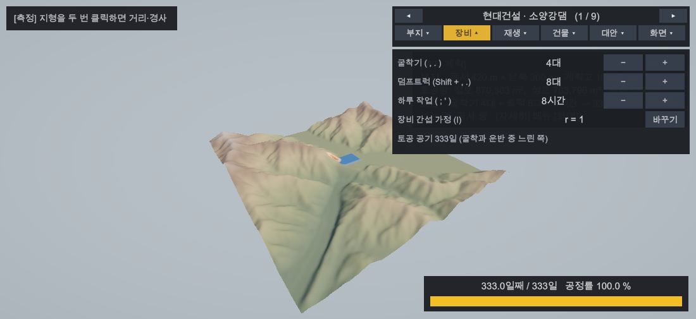

| 자리 | 무엇이 있나 |
|---|---|
| 오른쪽 위 | 메뉴: `◀ 현장 이름 ▶`, 그 아래 **[부지] [장비] [재생] [건물] [대안] [화면]** |
| 오른쪽 | 정보 글상자: 계산 결과 숫자 |
| 왼쪽 위 | 측정 안내, 건물 글상자, 공정표, 단면 |
| 가운데 | 3D 지형 |
| 아래 | 시간 막대(재생할 때), 터널이면 종단면 |

- **메뉴 열기:** 메뉴 이름을 누르면 그 아래에 버튼이 펼쳐지고, 다시 누르면 접힙니다.
- **괄호 안의 키:** 버튼 이름 옆 괄호는 같은 일을 하는 키입니다. 예: `부지 놓기 (G)`
- **글상자 접기:** 글상자 오른쪽 위의 **[접기 ▴]**를 누르면 핵심 숫자 한 줄만 남습니다. **[펼치기 ▾]**로 다시 펼칩니다.
- **흐린 버튼:** 지금 쓸 수 없는 버튼입니다. 예를 들어 부지를 놓기 전에는 재생 버튼이 흐립니다.

**카메라 조작**

| 조작 | 하는 일 |
|---|---|
| 왼쪽 드래그 | 돌리기 |
| 오른쪽 드래그 | 옮기기 |
| 휠 | 확대·축소 |
| `W A S D` | 옮기기 |
| `R` | 처음 시점으로 |

## 3. 처음 5분 따라 하기

**① [대안] → 예시 불러오기**

소양강댐 현장에 부지가 놓이고, 장비 조합 세 가지가 저장되고, 대안 비교표가 나옵니다.

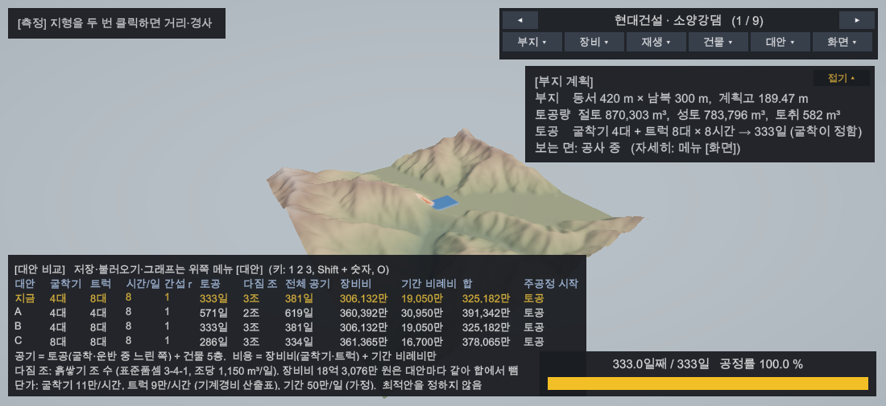

| 대안 | 굴착기 | 덤프트럭 | 전체 공기 | 읽는 법 |
|---|---|---|---|---|
| A | 4대 | 4대 | 619일 | 트럭이 모자라 굴착기가 기다림 |
| B | 4대 | 8대 | 381일 | 트럭만 늘렸는데 238일 단축, 비용도 감소 |
| C | 8대 | 8대 | 334일 | 굴착기를 두 배로 해도 47일만 단축 |

**② [재생] → 재생 (Space)**

굴착기가 덤프트럭에 흙을 싣고, 트럭이 흙을 붓고, 땅이 깎입니다. 토공이 끝나면 건물이 층별로 올라갑니다.

| 토공 | 건물 |
|---|---|
| 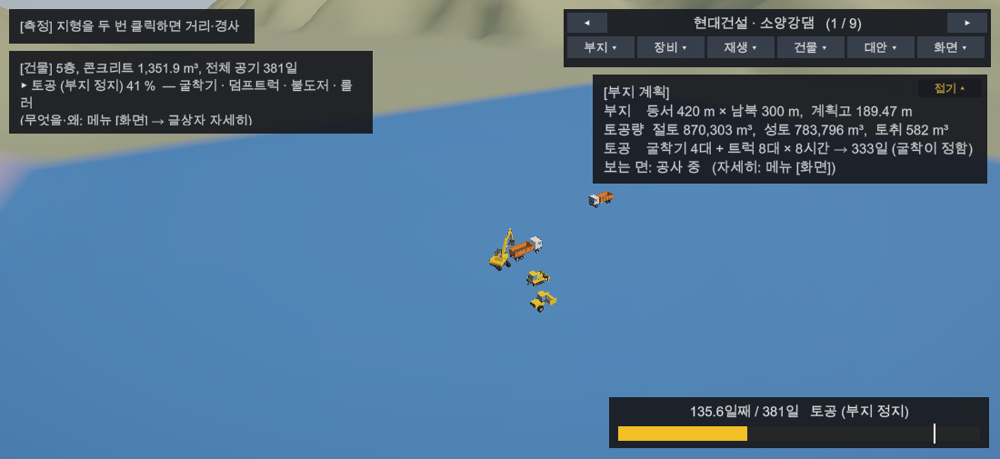 | 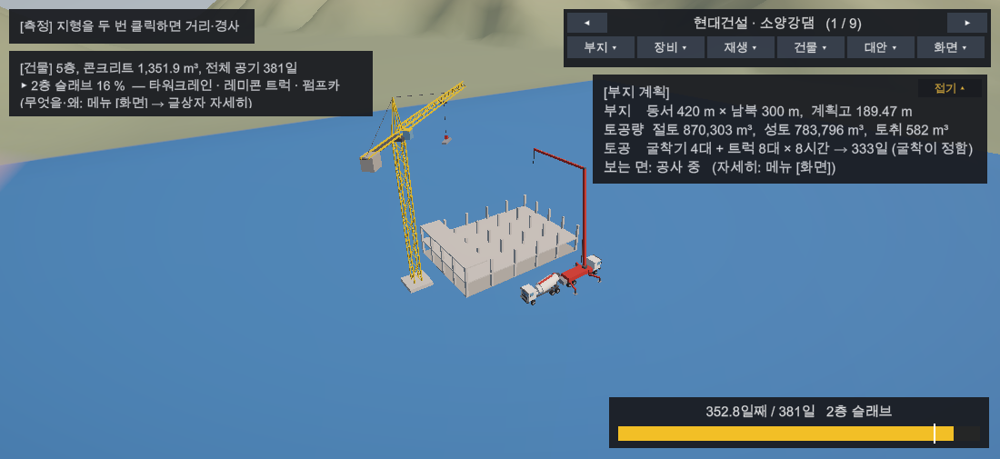 |

**③ [건물] → 공정표 보기 (P)**

CPM 공정표가 나옵니다. 가장 빠른·늦은 시작일, 여유, 주공정선을 볼 수 있습니다.

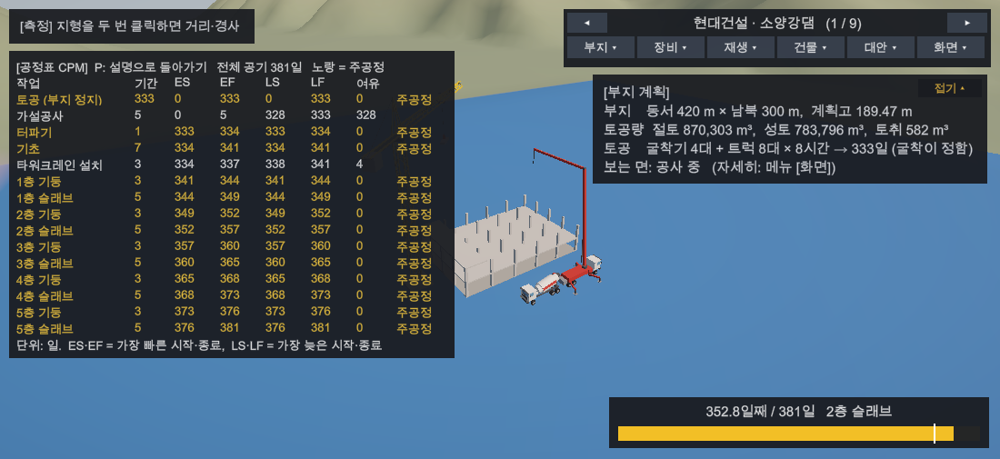

**④ [대안] → 댐 네트워크 공정표 → 존 단면 보기**

소양강댐을 실제로 지은 순서를 봅니다. 단계 버튼 1 ~ 12를 하나씩 눌러 보세요.

**⑤ [대안] → 보고서 저장**

결과가 `Reports` 폴더에 문서로 저장됩니다 ([7절](#7-보고서와-화면-저장)).

## 4. 위쪽 메뉴

### 현장 고르기

메뉴의 현장 이름을 누르면 현장 10개 목록이 펼쳐집니다. 회사 8곳, 랜드마크 인천대교, 시험용 수식 언덕입니다. `[댐]`·`[터널]` 표시는 그 현장에 구조물 모드가 있다는 뜻입니다. `◀ ▶` 또는 `[` `]` 키로도 넘길 수 있습니다.

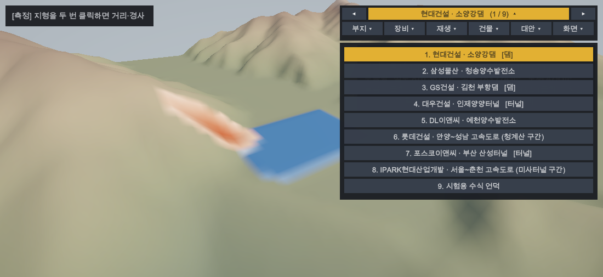

### [부지]

땅을 평평하게 만들 자리를 정합니다.

| 버튼 | 하는 일 |
|---|---|
| 부지 놓기 (G) | 화면 가운데에 부지를 놓습니다. `G` 키는 마우스가 가리키는 곳에 놓습니다 |
| 계획고 −10 −1 +1 +10 | 부지 높이를 바꿉니다. 절토·성토량이 바로 다시 계산됩니다 |
| 균형 계획고 찾기 (E) | 깎은 흙을 다져 쌓을 곳을 딱 채우는 높이를 찾습니다 (절토 × C = 성토) |
| 부지 크기 (9 0) | 부지 크기를 바꿉니다 |
| 암반선 깊이 (X) | 없음 → 1 → 2 → 5 → 10 → 20 m. 암을 넣으면 굴착이 느려지고, 암을 깨는 장비 대수가 나옵니다 |
| 보는 면 (V) | 계획면 / 원지반 / 공사 중 |
| ○○댐 쌓기 / ○○터널 굴착 | 댐·터널 현장에서만 나타납니다 |

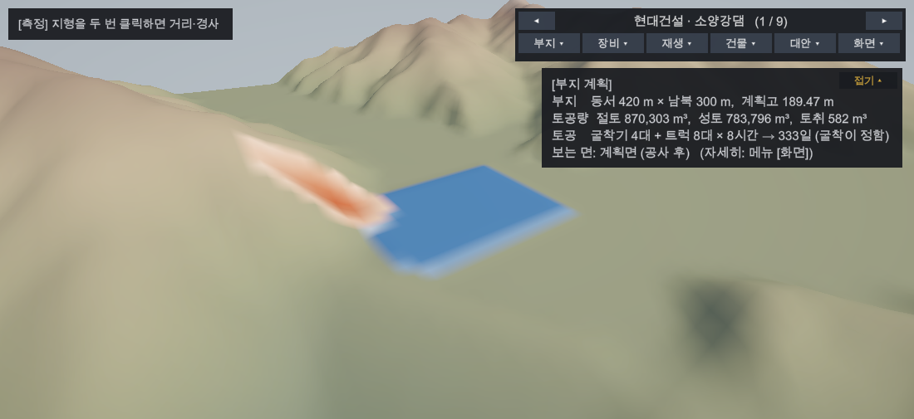

### [장비]

조건을 바꾸면 공기가 바로 다시 계산됩니다.

- **토공일 때:** 굴착기 대수, 덤프트럭 대수, 하루 작업 시간, 장비 간섭 가정. 토공 공기는 굴착과 운반 중 느린 쪽입니다.
- **터널일 때:** 하루 작업 시간, 로더 대수, 가운데 사갱, 라이닝 거푸집 조 수, 용수 할증(+30 %), 라이닝을 굴착과 병행할지.

### [재생]

| 버튼 | 키 |
|---|---|
| 처음 | `B` |
| 하루 앞뒤 (터널은 10일) | `N` `M` |
| 재생 / 멈춤 | `Space` |

재생 속도는 × 0.5 · 1 · 2 · 4 중에서 고릅니다.

### [건물]

| 버튼 | 키 |
|---|---|
| 건물·장비 보기 | `T` |
| 층수 | `K` `L` |
| 부지 가까이 보기 | `F` |
| 공정표 보기 | `P` |

### [대안]

| 버튼 | 하는 일 |
|---|---|
| 예시 불러오기 | 대표 예시 A·B·C를 한 번에 만듭니다 |
| 지금 조건 저장 A B C (`1 2 3`) / 불러오기 (`Shift` + 숫자) | 조건을 저장하고 불러옵니다. 결과는 지금 현장으로 다시 계산합니다 |
| 비교 화면 (`O`) | 비교표 → 그래프 |
| ○○ 네트워크 공정표 / ○○ 시공 단계 | 회사 구조물 현장에서만 ([6절](#6-네트워크-공정표와-시공-단계)) |
| 보고서 저장 | [7절](#7-보고서와-화면-저장) |
| 자동 문장 | 마지막 대안과 지금 조건을 숫자로 비교한 한 줄 |

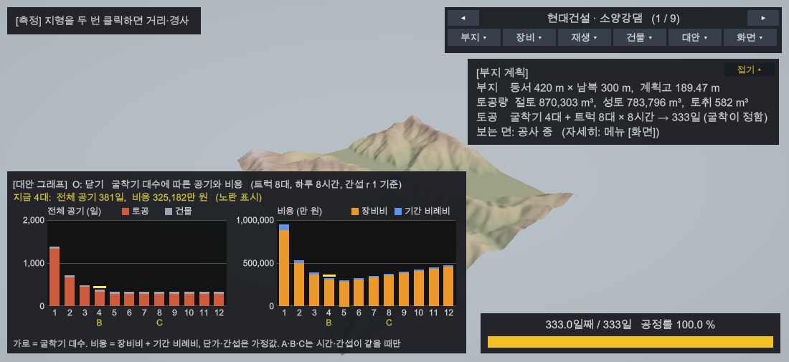

### [화면]

- 글상자 간단/자세히
- 한꺼번에 줄이기 (`Tab`)
- 글자 크기 4단계
- 항목별 켜기·끄기: 정보 글상자, 측정 안내, 표고 범례, 누적 토공 그래프, 터널 단면 모식도, 이름표, 시간 막대·종단면
- 처음 상태로, 키 안내 (`F1`), 화면 저장 (`F12`)

고른 설정은 다음 실행에도 남습니다.

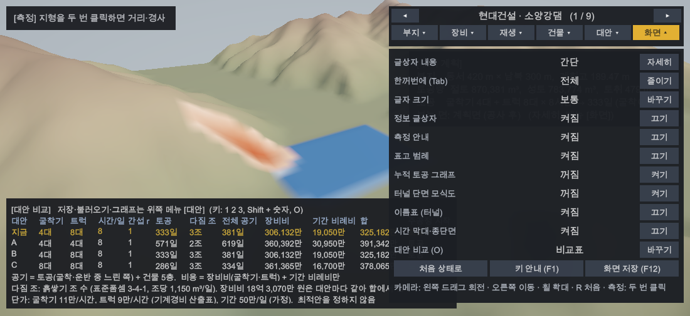

### 거리·경사 재기

지형을 두 번 클릭하면 두 점 사이의 거리, 높이 차, 경사가 나옵니다. `C`로 지웁니다.

## 5. 회사 구조물과 랜드마크

현장 이름을 눌러 현장을 고른 뒤 메뉴를 누릅니다.

| 현장 | 해 볼 것 | 보이는 결과 |
|---|---|---|
| 1. 현대건설 · 소양강댐 | [부지] → 소양강댐 쌓기 / [대안] → 댐 네트워크 공정표 → 존 단면 보기 → 3D로 보기 | 계산 체적이 공개 값과 −2.0 % 차이. 12단계, 코어·필터·사력 존, 단계별 장비 |
| 2. 삼성물산 · 청송양수 / 5. DL이앤씨 · 예천양수 | [대안] → 댐 네트워크 공정표 → 단계 보기 | 상·하부댐 두 단면과 지하 작업 막대 |
| 3. GS건설 · 부항댐 | [대안] → 댐 네트워크 공정표 → 단계 보기 → 표면차수벽 → [1개월 ▶] | 상류면 슬래브가 아래부터 올라감 |
| 4. 대우건설 · 인제양양터널 | [부지] → 인제양양터널 굴착 → `Space` | 막장 4개. 계산 관통 927일 ↔ 실제 878일 (+5.6 %). [장비]에서 사갱을 끄면 1,420일 |
| 6. 롯데건설 · 청계산3터널 / 7. 포스코이앤씨 · 산성터널 / 8. HDC · 미사터널 | [부지] → ○○터널 굴착 → `Space` | 관통일이 공개되지 않은 곳은 계산만 보여 주고, 실제와 % 비교는 하지 않습니다 |
| 9. 랜드마크 · 인천대교 | [대안] → 교량 네트워크 공정표 → 단계 보기 → 3D로 보기 | 논리 1,182일 ↔ 실제 1,553일. 주탑·상판·케이블 3D |

| 소양강댐 존 단면 | 소양강댐 3D | 인제양양터널 |
|---|---|---|
| 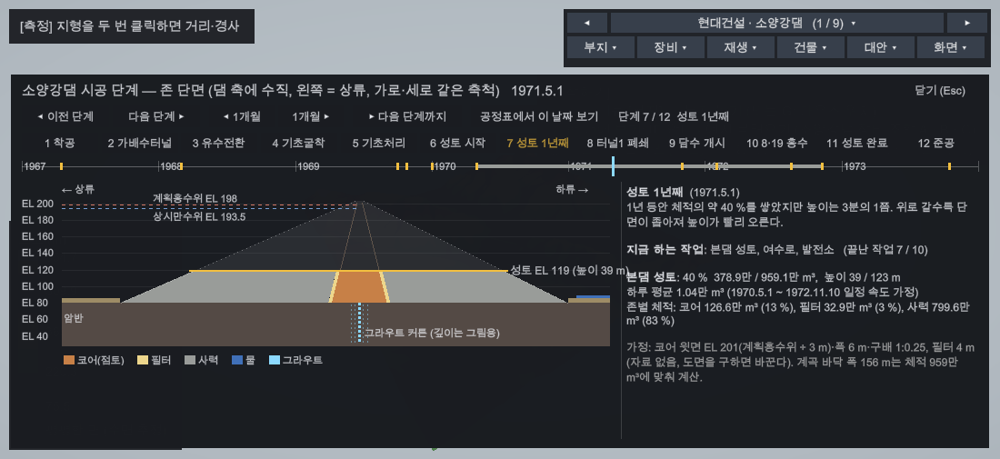 | 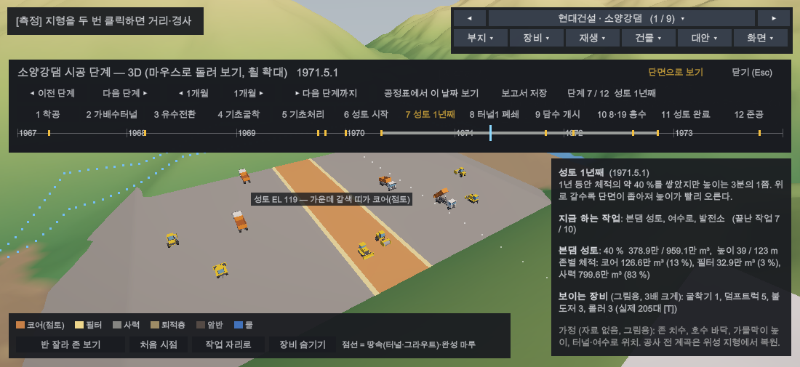 | 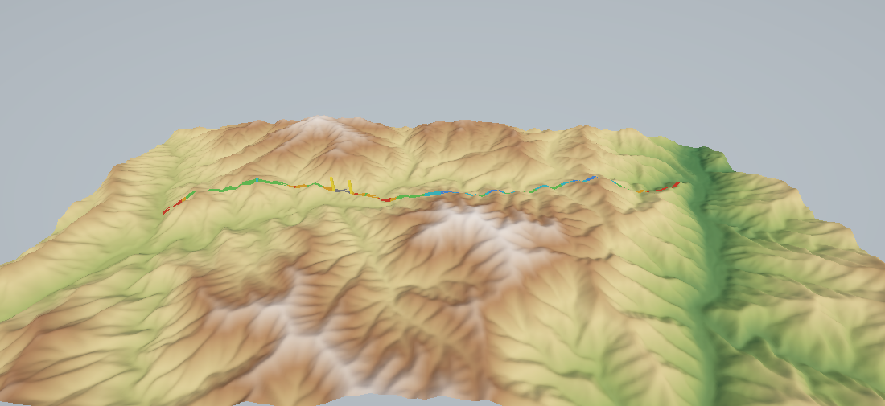 |

| 예천양수 단계 | 인천대교 공정표 | 인천대교 3D |
|---|---|---|
| 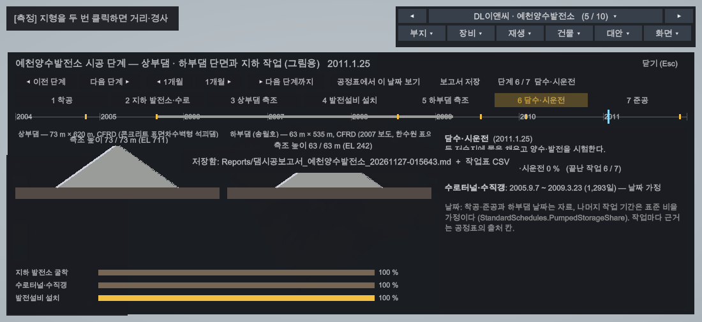 | 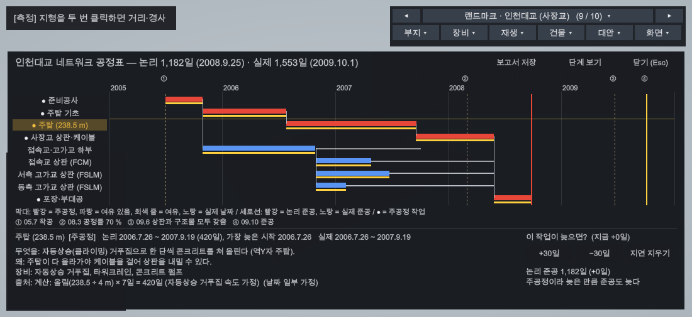 | 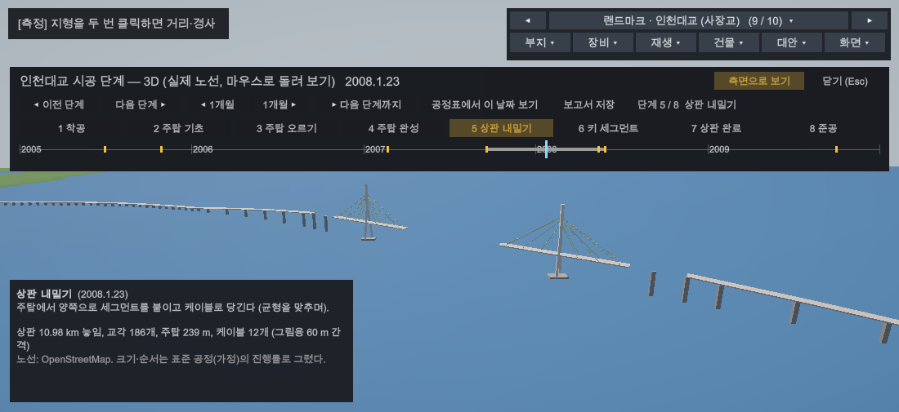 |

## 6. 네트워크 공정표와 시공 단계

### 네트워크 공정표

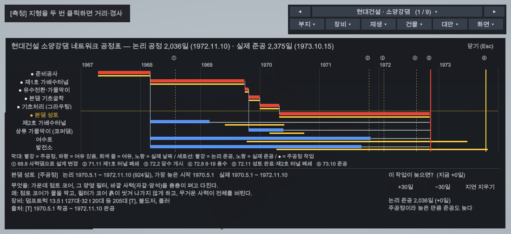

- **상자와 화살표:** 상자 하나가 작업 하나입니다. 화살표는 "앞 작업이 끝나야 시작"이라는 뜻입니다.
- **빨간 상자:** 주공정입니다. 하나라도 늦으면 준공이 늦어집니다.
- **작업 이름을 누르면:** 그 작업을 무엇을·왜·어떤 장비로 했는지 아래에 나옵니다.
- **[+30일] [−30일]:** 고른 작업을 늦춰 보고 준공이 어떻게 바뀌는지 다시 계산합니다. 여유가 있는 작업은 여유 안에서는 준공이 그대로입니다. [지연 지우기]로 되돌립니다.
- **논리 공정과 실제:** 논리 공정은 작업마다 앞 작업이 끝나자마자 시작했다고 보고 계산한 것이고, 실제는 자료의 날짜입니다. 둘을 나란히 보여 줍니다.
- **[존 단면 보기] / [단계 보기]:** 시공 단계 화면으로 갑니다.
- **[닫기 (Esc)]:** 공정표를 닫습니다.

### 시공 단계 (한 단계씩)

- **넘기는 방법:** 단계 버튼을 바로 누르거나 [◀ 이전 단계] [다음 단계 ▶], [◀ 1개월] [1개월 ▶]로 넘깁니다.
- **[▶ 다음 단계까지]:** 한 달씩 나아가다 다음 단계에서 멈춥니다.
- **[3D로 보기]:** 소양강댐과 인천대교에서 쓸 수 있습니다. 돌아올 때는 [단면으로 보기](소양강댐), [측면으로 보기](인천대교)를 누릅니다.
- **[공정표에서 이 날짜 보기]:** 지금 날짜를 네트워크 공정표에서 봅니다.
- **3D에서 쓰는 버튼:** [반 잘라 존 보기], [작업 자리로], [장비 숨기기], [처음 시점]
- **"가정"·"그림용":** 화면에 이렇게 적힌 것은 자료가 없어서 정한 값입니다.

| 8·19 홍수: 두 기록 비교 | 3D 반 잘라 존 보기 |
|---|---|
| 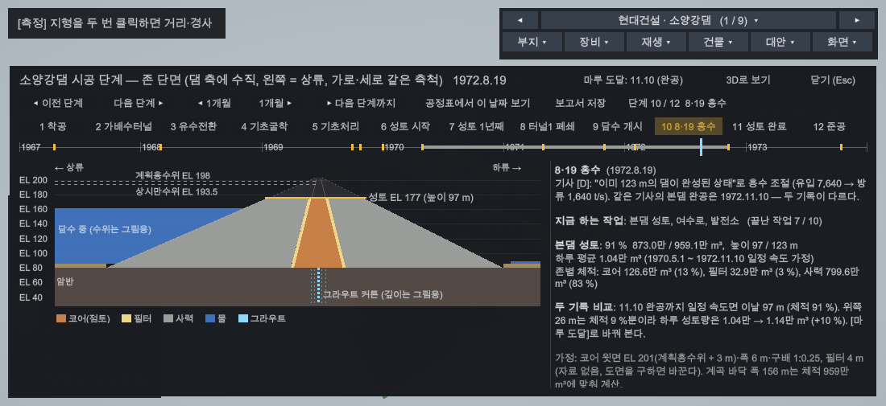 | 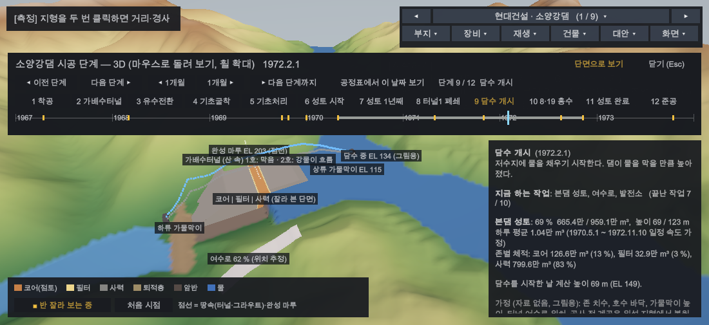 |

## 7. 보고서와 화면 저장

| 무엇 | 어디에 |
|---|---|
| 보고서 저장 → 보고서(`.md`) + 작업표(`.csv`, 엑셀) | `CivilTwin.exe` 폴더 안의 `Reports` |
| 화면 저장 (`F12`) → PNG | `CivilTwin.exe` 폴더 안의 `Logs\captures` |

**보고서에 들어가는 것**
- CPM 표 (ES·EF·LS·LF·여유)
- 네트워크 그림
- 논리 공정과 실제 날짜 비교
- 작업마다 30·180·400일 늦을 때의 영향
- 시공 단계, 물량, 대안 비교
- 가정과 출처

**보고서 열기**
- `.md`는 메모장으로도 열립니다.
- VS Code나 GitHub에서 열면 표와 그림이 보입니다.

**예시 보고서**
- [Docs/examples/report-soyanggang.md](examples/report-soyanggang.md)

## 8. 키 목록

`F1`을 누르면 화면에도 나옵니다.

| 키 | 동작 | 키 | 동작 |
|---|---|---|---|
| 드래그 / 휠 / `WASD` · `R` | 회전·이동 / 확대 / 이동 · 처음 시점 | `[` `]` | 이전·다음 현장 |
| 클릭 두 번 · `C` | 두 점 측정 · 지우기 | `G` · `E` | 부지 놓기 · 균형 계획고 |
| `−` `=` (`Shift` 10 m) | 계획고 ∓1 m | `9` `0` · `X` | 부지 크기 · 암반선 깊이 |
| `,` `.` / `Shift` + `,` `.` | 굴착기 / 덤프트럭 대수 | `;` `'` · `I` | 하루 작업 시간 · 장비 간섭 |
| `Space` · `N` `M` · `B` | 재생 · 앞뒤 · 처음 | `V` | 계획면 · 원지반 · 공사 중 |
| `T` · `F` · `P` · `K` `L` | 건물 · 가까이 · 공정표 · 층수 | `1` `2` `3` / `Shift` + 숫자 · `O` | 대안 저장 / 불러오기 · 비교 |
| `Tab` | 글상자 줄이기·숨기기 | `F1` · `F12` · `Esc` | 키 안내 · 화면 저장 · 닫기 |

## 9. 숫자를 읽을 때

- **계수의 출처:** 계수와 장비 작업량 식은 2025년 적용 건설공사 표준품셈에서 가져왔습니다. 출처는 [ASSUMPTIONS.md](ASSUMPTIONS.md)에 정리했습니다.
- **가정:** 자료가 없는 값은 계산하거나 표준 값을 쓰고 **"가정"**으로 표시했습니다. 공정 기간은 ① 자료의 날짜 → ② 계산 → ③ 표준 비율의 순서로 채웠습니다.
- **비용:** 장비비와 기간 비례비만 더한 **비교용 일부 항목**이고, 실제 공사비가 아닙니다.
- **지형:** 30 m 간격 위성 자료(DSM)라 설계 정밀도가 아닙니다. 바다는 0 m로 평평하게 나옵니다.
- **장비 화면:** 장비의 모양과 움직임은 보기용이고, 공기 계산과는 따로 움직입니다.
- **최적안:** 프로그램은 어느 대안이 "최적"이라고 정하지 않습니다. 숫자를 나란히 보여 줄 뿐입니다.

## 10. 문제가 생기면

**실행하자마자 꺼지거나 화면이 검을 때**

Vulkan 그래픽으로 실행해 봅니다.
1. `CivilTwin.exe`를 오른쪽 클릭 → [바로 가기 만들기]
2. 바로 가기를 오른쪽 클릭 → [속성]
3. [대상] 끝에 한 칸 띄우고 `-force-vulkan`을 붙입니다. 예: `"D:\CivilTwin\CivilTwin.exe" -force-vulkan`
4. 그 바로 가기로 실행합니다.

그래픽 드라이버를 최신으로 바꾸는 것도 방법입니다.

**매끈한 언덕만 나올 때**

`CivilTwin.exe` 옆에 `Data\sites` 폴더가 있는지 확인합니다. 압축을 모두 풀어야 합니다.

**버튼이 안 눌리는 것 같을 때**

흐린 버튼은 지금 쓸 수 없는 버튼입니다. 재생은 부지를 놓은 뒤에, 네트워크 공정표는 회사 구조물 현장에서 됩니다.

**글자 크기가 맞지 않을 때**

[화면] → 글자 크기, 또는 처음 상태로.

## 자료 출처

- **지형:** Copernicus DEM GLO-30. © DLR e.V. 2010-2014 and © Airbus Defence and Space GmbH 2014-2018 provided under COPERNICUS by the European Union and ESA; all rights reserved.
- **노선:** © OpenStreetMap contributors (ODbL)
- **계수:** 2025년 적용 건설공사 표준품셈, 건설기계 기계경비 산출표
- **구조물 제원·날짜:** 공개 자료. 현장별 출처는 [SITES.md](SITES.md)와 [ASSUMPTIONS.md](ASSUMPTIONS.md)에 있습니다.
