# CIVIL TWIN

**실제 지형 위에서 토공·건물·댐·터널·교량 공사를 시간에 따라 재생하고, 장비 조건을 바꾸면 공기와 비용이 어떻게 달라지는지 비교하는 3D·4D 시공계획 시뮬레이터**입니다. Unity로 만들었습니다. 현장은 시공능력평가 상위 건설사 8곳이 시공(또는 참여)한 곳이고, **그 회사가 만든 구조물 8개**(댐 2 · 양수발전소 2 · 터널 4)와 **랜드마크 인천대교**를 공개 자료로 다시 만들어 네트워크 공정표 · 시공 단계 · 보고서로 보여 줍니다.

토목공학 전공자가 만든 포트폴리오 프로젝트입니다. 목표는 화려한 화면보다 **"모든 숫자를 손계산으로 설명할 수 있는 프로그램"**입니다. 계산 코드는 모두 손계산 값과 비교하는 자동 테스트(389개)를 통과하고, 계수와 장비 단가는 [2025년 적용 건설공사 표준품셈과 건설기계 기계경비 산출표](Docs/ASSUMPTIONS.md)와 대조했습니다.

> [!TIP]
> **바로 실행해 보기:** 오른쪽 **Releases**에서 `CivilTwin-Windows.zip`을 받아 압축을 풀고 `CivilTwin.exe`를 실행합니다 (설치 필요 없음, Windows 64비트).
> 실행 후 위쪽 메뉴 **[대안] → 예시 불러오기**를 누르면 대표 예시(소양강댐 장비 조합 비교)가 한 번에 만들어집니다.
>
> 📘 [사용설명서](Docs/MANUAL.md) · 📄 [프로그램 한 장 소개](Docs/ABOUT.md)

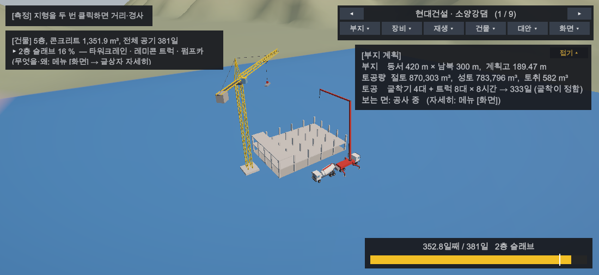

*소양강댐 주변 지형 위의 부지. 토공을 마친 뒤 5층 건물의 2층 슬래브를 치는 353일째. 왼쪽은 지금 하는 일과 쓰는 장비, 아래는 전체 공기 381일의 시간 막대.*

> [!NOTE]
> 실제 설계·공정 프로그램(Civil 3D, Primavera P6 등)을 대체하려는 것이 아닙니다. 시공계획의 계산 원리를 구현하고 검증하는 것이 목적입니다. 지형 자료는 30 m 간격의 위성 DSM이라 설계 정밀도가 아닙니다.

## 무엇을 하나

시공계획서를 만드는 순서대로 따라가며, 각 단계의 계산 결과를 화면과 숫자로 보여 줍니다.

| 순서 | 하는 일 | 계산 | 실무에서는 |
|---|---|---|---|
| 1 | 현장 고르기 (실제 지형 8곳) | 위성 DEM → 미터 좌표 3D 지형, 표고·거리·경사 측정 | 현황 측량, 지형 검토 |
| 2 | 부지 놓기, 계획고 정하기 | 절토량·성토량 (삼각형 점고법), 비탈 구배 | 토공 설계 |
| 3 | 토량 균형 맞추기 | 토량환산계수 L·C, 사토·토취량, 균형 계획고 자동 탐색 (이분법), 토사·암 구분 | 토량 배분 계획 |
| 4 | 장비 정하기 | 굴착기·덤프트럭 작업량, 평균 운반거리, **공기 = 굴착과 운반 중 느린 쪽** | 장비 조합 계획 |
| 5 | 4D 재생 | 날짜별 지형 변화 → 건물이 층별로 올라감, 단계별 장비와 설명 | 공정 시뮬레이션 |
| 6 | 공정표 보기 | CPM: 가장 빠른·늦은 시작일, 여유, 주공정선 | 공정 관리 |
| 7 | 대안 비교 | 대안별 공기, 장비비, 기간 비례비, 주공정선 변화 | 시공 대안 검토 |
| + | 회사 구조물: 댐 (소양강댐, 부항댐) | 공개 제원으로 댐 단면, 위성 지형에서 공사 전 계곡 복원·사면 구배 측정 → 댐 체적을 공개 값과 비교 | 준공 구조물로 계산 방법 검증 |
| + | 회사 구조물: 터널 (인제양양·산성·청계산3·미사터널) | 표준품셈 1발파 싸이클 × 지보 패턴 × 막장 공정 → 관통일을 실제와 비교, 사갱·로더 대안 | 터널 공정 계획 |
| + | 회사 구조물: 양수발전소 (청송·예천) | 상·하부댐 + 지하 발전소·수로·설비의 공정 | 플랜트 토목 공정 |
| + | 모든 구조물 공통: 네트워크 공정표 · 시공 단계 · 보고서 | 자료의 날짜 → 계산 → 표준 공정(가정) 순서로 기간을 채우고 CPM | 공정 계획서 |
| + | 랜드마크: 인천대교 (사장교) | 구간 구성(고가교 FSLM · 접속교 FCM · 사장교), 표준 시공 속도 공정을 자료와 비교, 측면·3D 단계 | 교량 가설 계획 |

### 부지와 토량 균형

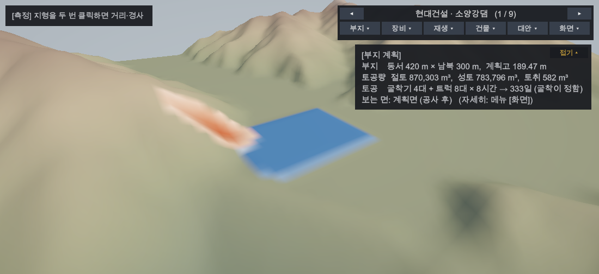

`E` 키를 누르면 깎은 흙을 다져서 성토를 딱 채우는 계획고(절토 × C = 성토)를 찾습니다. 계획고를 올리면 절토는 줄고 성토는 늘어나므로, 지형의 가장 낮은 높이와 가장 높은 높이 사이를 반씩 좁혀 가며 찾습니다. 위 화면에서는 189.47 m가 나왔고, 절토 870,303 m³ × 0.90 = 783,272 m³로 성토 783,796 m³와 맞습니다.

### 토공과 건물의 4D 재생

| 토공 중 (굴착기, 덤프트럭, 불도저, 롤러) | 건물 공사 (타워크레인, 펌프카, 레미콘) |
|---|---|
| 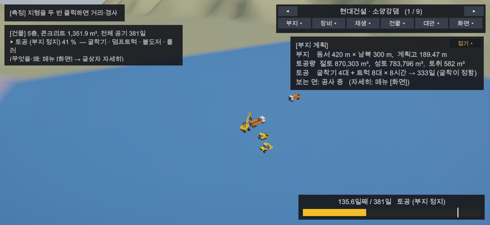 | 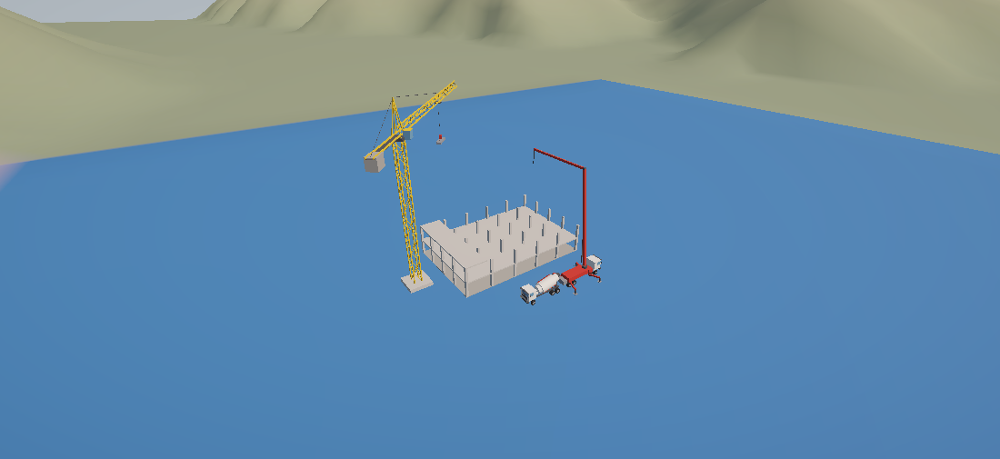 |

시간 막대 하나로 토공 → 터파기 → 기초 → 층별 기둥·슬래브를 재생합니다.

장비는 3D 모델 파일 없이 코드로 만들었고, 실제 장비 구조를 따라 부품을 나눴습니다 (굴착기 = 무한궤도·선회체·굽은 붐·암·버킷·유압 실린더, 덤프트럭 = 3축 복륜·캡오버 운전실·적재함 등). 굴착기는 **표준품셈 사이클 시간 Cm(19초) 한 번에 굴착 → 적재 선회 → 덤프 → 복귀 선회**를 하고, 트럭 한 대를 채우는 버킷 횟수 n(= 트럭 적재량 ÷ (q × K), 15 t·점질토면 12.25 → 13번)만큼 실으면 트럭이 떠나고 다음 트럭이 들어옵니다. 적재함의 흙은 버킷마다 한 칸씩 찹니다. 다 실은 트럭은 반대편 끝에서 돌아 멈춘 뒤 호이스트 실린더로 적재함을 들어 흙을 붓고 돌아옵니다. 단계별 시간 비율과 관절 각도, 이동 속도는 보기용 가정입니다.

| 굴착 (붐·암·버킷 관절) | 트럭 두 대에 번갈아 싣기 | 적재함을 들어 흙 붓기 |
|---|---|---|
| 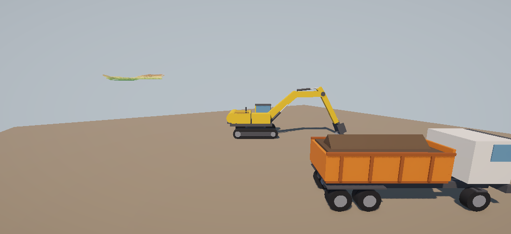 | 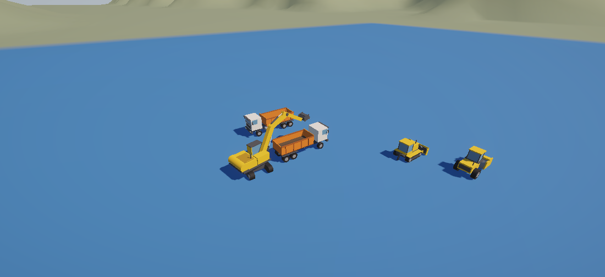 | 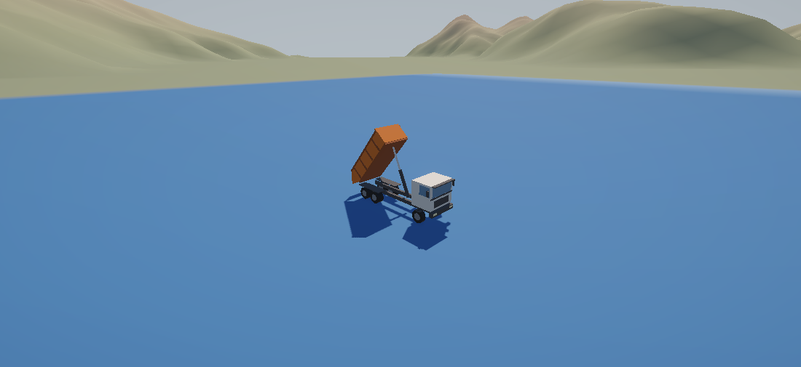 |

### CPM 공정표

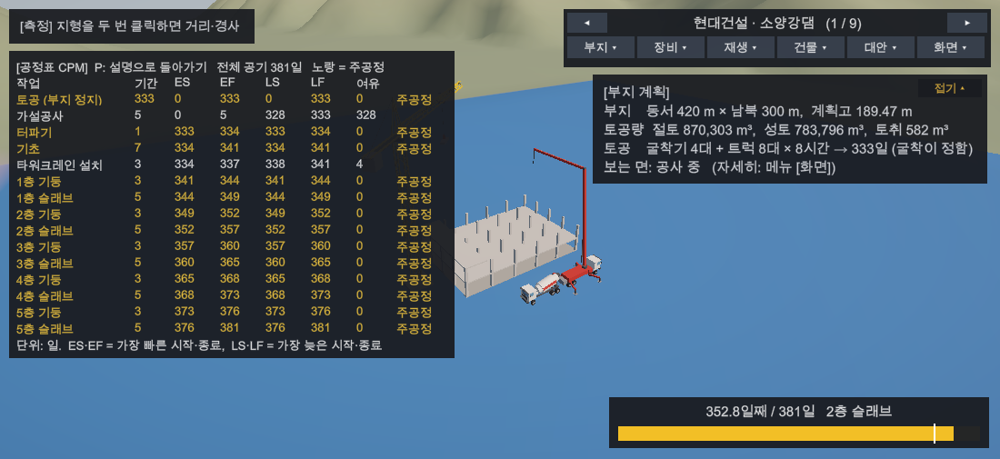

전진 계산(ES, EF)과 후진 계산(LS, LF)으로 여유와 주공정선을 구합니다. 위 화면에서 토공이 333일로 길어서 주공정선은 토공 → 터파기 → 기초 → 층별 공사이고, 가설공사는 여유가 328일, 타워크레인 설치는 4일입니다.

## 소양강댐 네트워크 공정표 (시공 순서 · CPM)

소양강댐 현장에서 **[대안] → 댐 네트워크 공정표**를 누르면, 공개 자료로 다시 짠 실제 공사 순서(1967 ~ 1973)를 공정표로 봅니다.

- **작업 10개:** 준비공사 → 제1호 가배수터널 → 유수전환·가물막이 → 기초굴착 → 기초처리(그라우팅) → 본댐 성토, 그리고 함께 진행된 제2호 가배수터널·상류 가물막이·여수로·발전소. 날짜는 모두 출처가 있습니다 (K-water연구원 보고서 연표, 대한경제·티티씨뉴스 기사, 한국민족문화대백과사전). 끝나는 날을 모르는 작업은 다음 작업 시작일로 둔 가정입니다.
- **논리 공정 (CPM):** 각 작업이 선행 작업이 끝나자마자 시작한다고 보면, 주공정은 "강물을 돌리고 → 기초를 만들고 → 쌓는" 순서이고 1972.11.10(2,036일)에 끝납니다.
- **실제와 비교:** 실제 준공은 1973.10.15(2,375일)입니다. 여수로는 여유가 361일 있었는데 실제로는 여유를 232일 넘겨 늦게 시작해(1969.10.15) 1973.6.30에 끝났습니다. 늦게 시작한 이유는 자료에 없어 추정하지 않았습니다.
- **"이 작업이 늦으면?":** 작업을 고르고 [+30일]을 누르면 다시 계산합니다. 주공정인 가배수터널이 30일 늦으면 준공도 30일 늦고, 여수로는 361일 안에서는 그대로입니다.
- 작업마다 무엇을·왜·장비를 적었습니다 (예: 본댐 성토 = 점토 코어·필터·사력을 층층이, 덤프트럭 13.5 t 127대·32 t 20대 등 205대).

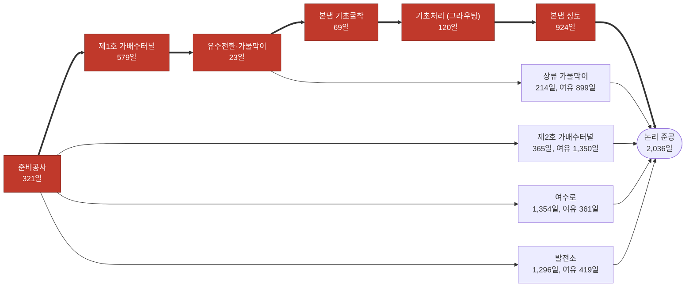

*빨간 상자 = 주공정. 관계는 모두 끝 → 시작. 프로그램이 저장하는 보고서에 같은 그림이 들어갑니다.*

| 공정표 (본댐 성토 선택) | 여수로: 여유 361일, 실제로는 232일 넘겨 늦게 시작 |
|---|---|
| 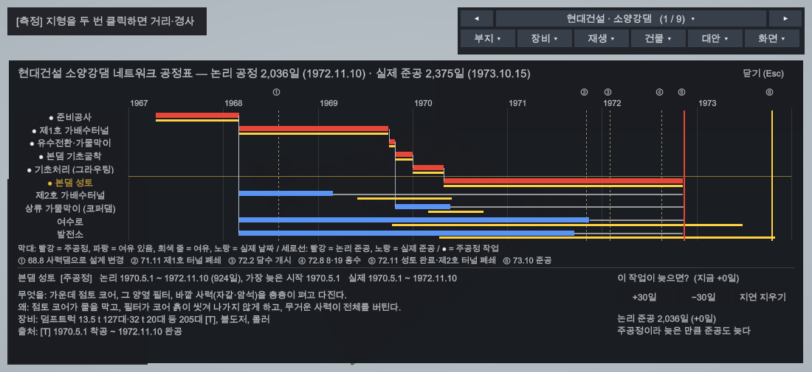 | 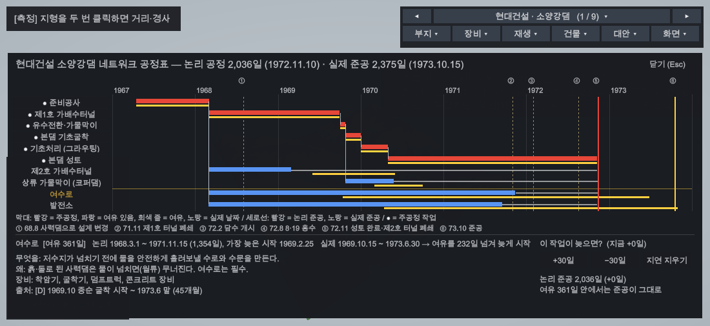 |

### 시공 단계 · 존 단면 (한 단계씩)

**[대안] → 댐 시공 단계 · 존 단면**을 누르면 댐 축에 수직인 단면(왼쪽 = 상류, 가로·세로 같은 축척)이 날짜에 맞춰 바뀝니다. 공정표에서 [존 단면 보기]를 눌러도 됩니다.

- **12단계:** 착공(강이 흐르는 계곡) → 가배수터널 → 유수전환(강물을 터널로) → 기초굴착(퇴적층 걷어 내기) → 기초처리(그라우트 커튼) → 성토 시작 → 성토 1년째 → 제1호 터널 폐쇄 → 담수 개시 → 8·19 홍수 → 성토 완료 → 준공.
- **넘기는 방법:** 단계 버튼을 바로 누르거나 [◀ 이전 단계] [다음 단계 ▶], [◀ 1개월] [1개월 ▶]로 넘깁니다. [▶ 다음 단계까지]는 한 달씩 나아가다 **다음 단계에서 멈춥니다**.
- **존:** 점토 코어·필터·사력을 같은 높이로 층층이 쌓습니다. 체적 959만 m³ 중 코어 126.6만(13 %), 필터 32.9만(3 %), 사력 799.6만(83 %)입니다.
- **날짜별 높이:** 계곡을 사다리꼴(바닥 폭은 공식 체적에 맞춰 계산한 156 m, 마루 530 m)로 보고, 성토 기간(1970.5.1 ~ 1972.11.10, 924일) 동안 하루 1.04만 m³씩 쌓는다고 가정했습니다. 단면은 아래가 훨씬 넓어 체적의 63 %가 아래쪽 절반 높이에 들어갑니다. 그래서 처음에는 높이가 천천히, 나중에는 빨리 오릅니다.
- **맞지 않는 두 기록 비교:** 한 기사는 8·19 홍수(1972.8.19) 때 "이미 123 m의 댐이 완성된 상태"였다고 쓰고, 같은 기사가 본댐 완공을 1972.11.10으로 적습니다. 11.10까지 일정 속도로 쌓았다면 그날 97 m입니다. 어느 쪽인지 정하지 않고 오른쪽 위 **[마루 도달: 11.10 / 8·19]**로 바꿔 봅니다 (3D·보고서도 따라감). 계산해 보면 높이로는 26 m 차이지만 위쪽은 단면이 좁아 체적으로는 9 %, **하루 성토량으로는 10 %(1.04만 → 1.14만 m³) 차이**뿐이고, 덤프트럭 운반 검산의 가능·불가능 판정도 같습니다.
- **가정:** 존 치수(코어 윗면 EL 201 = 계획홍수위 198 + 3 m, 윗면 폭 6 m, 구배 1:0.25, 필터 4 m), 퇴적층 두께, 그라우트 깊이, 담수 중 수위는 자료가 없어 그림에 "가정·그림용"으로 표시했습니다. 도면을 구하면 바꿉니다. 상시만수위 EL 193.5 m와 계획홍수위 EL 198.0 m는 학술 논문의 제원 표에 있는 값입니다(검색 결과로 확인했고 원문 표는 보지 못함).

| 성토 1년째 (재생하면 이 단계에서 멈춤) | 8·19 홍수: 두 기록 비교 (11.10 완공이면 97 m ↔ 기사 123 m) |
|---|---|
| 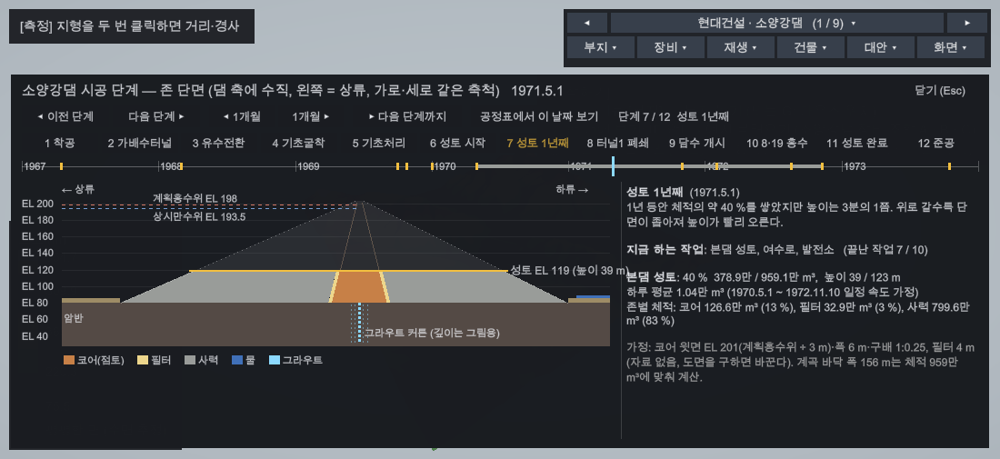 | 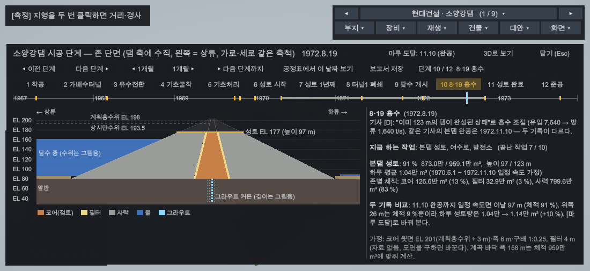 |

### 시공 단계 3D (같은 단계를 3D로)

존 단면 화면 오른쪽 위의 **[3D로 보기]**를 누르면 같은 날짜·단계가 3D로 바뀝니다 (마우스로 돌려 보기, 휠 확대, [단면으로 보기]로 돌아감).

- **공사 전 계곡:** 위성 지형(이미 댐과 호수가 있음)에서 댐 둘레는 양안 사면을 연장해 복원하고, 호수 바닥은 물가에서의 거리 × 양안 기울기로 추정했습니다(그림용). 그래서 담수 전에는 호수 대신 강이 흐르는 계곡이 보입니다.
- **단계마다 보이는 것:** 가배수터널을 양쪽에서 뚫는 점선(주황) → 유수전환 뒤 상·하류 가물막이와 마른 하상, 터널로 흐르는 물(파랑 점선) → 퇴적층을 걷어 낸 암반 → 그라우트 커튼 점선 → 성토 윗면의 코어(갈색)·필터(노랑) 띠와 사력 사면 → 담수(상류에서 이어진 낮은 곳만 채움) → 준공(상시만수위). 여수로는 공정에 맞춰 콘크리트 수로가 늘어납니다.
- **[반 잘라 존 보기]:** 계곡 가운데에서 댐을 잘라 코어·필터·사력 단면을 3D로 보여 줍니다.
- **가정(그림용):** 호수 바닥, 가물막이 높이(상류 EL 100 → 1970.10 체절 때 115, 하류 95), 가배수터널 위치, 여수로 위치(위성 지형의 낮은 길에서 읽음, 도면으로 검증되지 않음).

| 성토 1년째: 윗면의 코어·필터 띠 | 담수 개시: 반 잘라 본 존 단면과 저수지 |
|---|---|
| 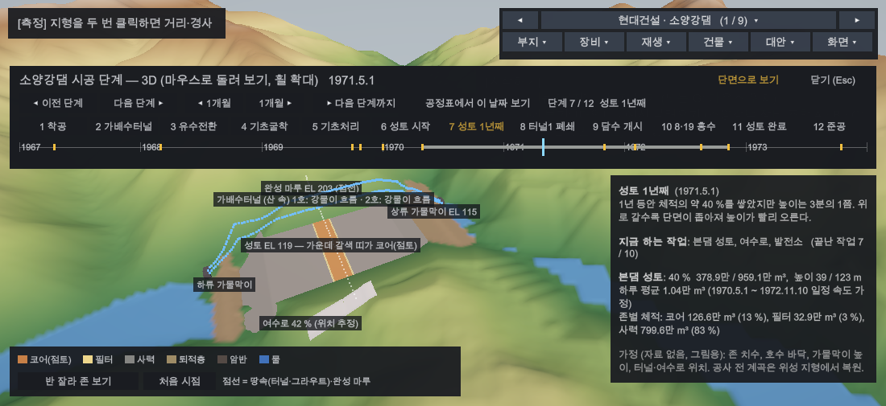 | 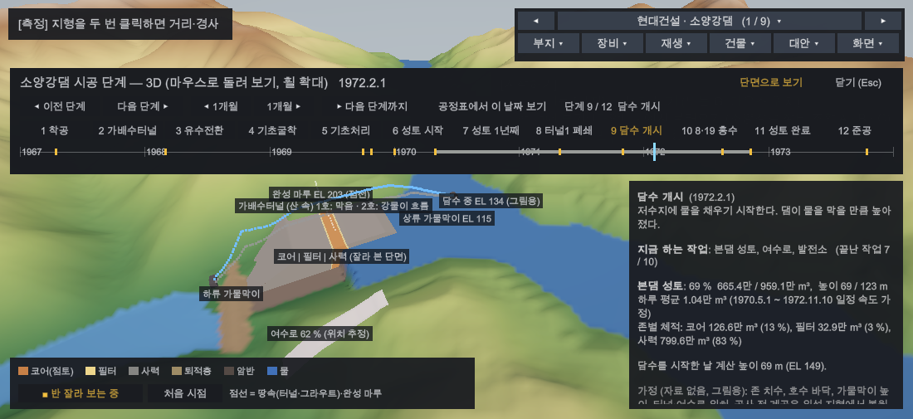 |

**장비:** 단계마다 맞는 장비가 작업 자리에서 움직입니다. 터널 입구의 굴착기·덤프트럭 → 가물막이의 덤프트럭·불도저 → 기초굴착의 굴착기 → 그라우팅의 천공 장비 → 성토의 덤프트럭(부리기)·불도저(펴기)·롤러(댐 축과 나란히 다짐) → 여수로. [작업 자리로]를 누르면 가까이 보고, [장비 숨기기]로 끕니다. 대수·동선은 그림용이고(자료의 실제 장비는 205대) 잘 보이도록 3배로 그렸습니다.

| 기초굴착: 퇴적층을 걷어 암반을 드러냄 | 성토: 코어와 사력을 같은 높이로 |
|---|---|
| 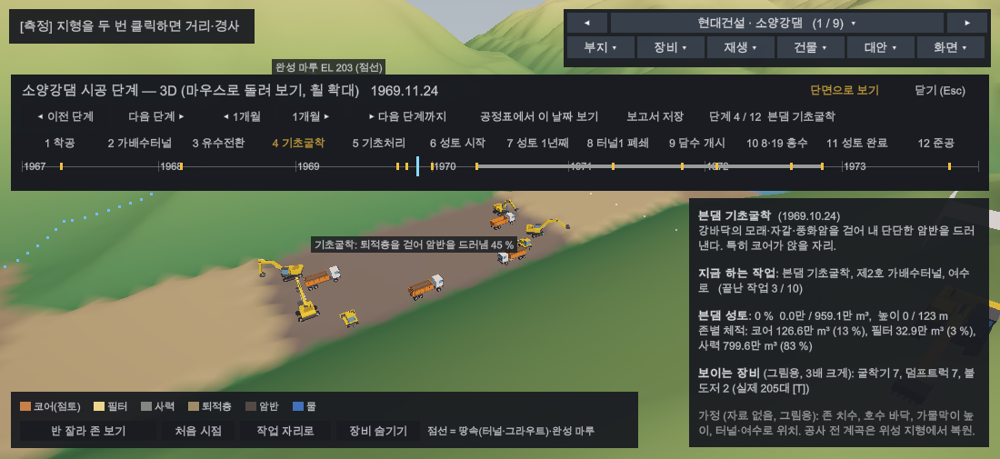 | 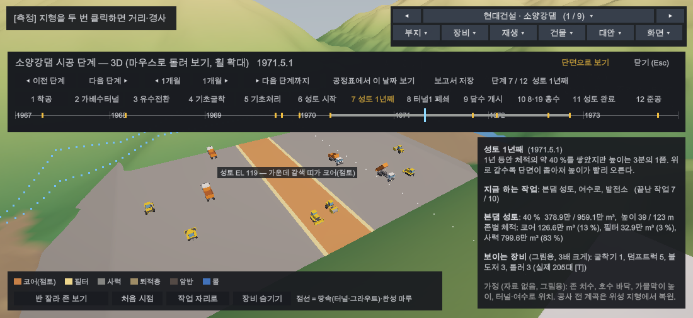 |

### 댐 시공계획 보고서

공정표·존 단면·3D 화면의 **[보고서 저장]**을 누르면 `Reports` 폴더에 보고서(Markdown)와 작업표(CSV, 엑셀용)가 저장됩니다. 네트워크 그림, CPM 표(ES·EF·LS·LF·여유), 논리 공정과 실제 날짜, 작업마다 30·180·400일 늦을 때의 영향, 시공 단계, 3개월마다의 성토 높이, 존별 물량, 운반 검산, 가정과 출처가 들어갑니다. 공정표에서 넣은 지연도 요약에 적힙니다.

**운반 검산:** "자료의 덤프트럭(13.5 t 127대 + 32 t 20대)으로 하루 10,380 m³를 나를 수 있었나?" 하루 20,760 t ÷ 한 바퀴 2,354.5 t = 대당 하루 8.8번. 4 km 왕복은 약 37분(표준품셈 8-2-8 속도)이라, 매일 8시간이면 한 번에 54분씩 쓸 수 있어 가능합니다. 비·혹한기로 60 %만 일하면 8시간 작업으로는 33분뿐이라 모자라고, 16시간 작업이면 65분으로 가능합니다. 다진 단위중량 2.0 t/m³·적재 4분·사력 운반거리 4 km는 가정이고, 트럭이 모두 본댐에만 쓰였다고 본 어림입니다.

## 모든 구조물을 같은 틀로 — 네트워크 공정표 · 시공 단계 · 보고서

어느 회사에 지원하든 그 회사의 구조물을 같은 깊이로 보여 주려고, 소양강댐에서 만든 공정 화면을 **구조물 공통 틀**(`Core/ConstructionSchedule.cs`, `Core/StandardSchedules.cs`)로 바꿨습니다. 구조물마다 다른 것은 자료 묶음뿐입니다. 현장에서 **[대안] → ○○ 네트워크 공정표 / ○○ 시공 단계**를 누릅니다.

| 회사 | 구조물 | 종류 | 공정 기간을 채운 방법 |
|---|---|---|---|
| 현대건설 | 소양강댐 | 사력댐 | 공개 연표의 실제 날짜 15개 (가장 깊음: 존 단면·3D·장비·운반 검산) |
| GS건설 | 부항댐 | 표면차수벽형 석괴댐 | 착공·준공은 자료, 가운데는 소양강댐 실제 공정 비율 (가정) |
| 대우건설 | 인제양양터널 | NATM 터널 | 굴착 시작·사갱·관통·개통은 자료, 2차 라이닝은 길이로 계산 |
| 포스코이앤씨 | 산성터널 | NATM 터널 | 착공·관통·개통 자료, 굴착 시작은 가정 |
| 롯데건설 | 청계산3터널 (안양~성남) | NATM 터널 | 착공 2012.6·개통 자료, 관통은 계산 막장 속도로 가정 |
| HDC현대산업개발 | 미사터널 (서울~춘천) | NATM 터널 | 착공 2004.8·개통 자료, 관통은 가정 |
| 삼성물산 | 청송양수발전소 | 상·하부댐 + 지하 발전소 | 착공 2000.9·준공 2006.12 자료, 작업 기간은 표준 비율 (가정) |
| DL이앤씨 | 예천양수발전소 | 상·하부댐(CFRD) + 지하 발전소 | 공사 2004.11 ~ 2011.12, 하부댐 2009.9 ~ 2010.6은 자료 |
| 랜드마크 | 인천대교 | 사장교 | 착공·준공 자료, 작업 기간은 표준 시공 속도로 계산 → 자료 확인점과 비교 |

- **원칙:** 기간은 ① 자료의 날짜 → ② 계산(라이닝 = 대차 조립 4일 + 올림(길이 ÷ 거푸집 2조 ÷ 12 m), 주탑 = 올림(높이 ÷ 4 m) × 7일 등) → ③ 표준 비율의 순서로 채웁니다. ②·③은 공정표의 출처 칸과 보고서에 **가정**으로 적습니다.
- **단계 화면:** 터널은 종단 막대(막장이 관통일에 만나고 라이닝이 따라감), 댐은 단면 윤곽(표면차수벽이 상류면 아래부터), 양수발전소는 상·하부댐 두 단면과 지하 작업 진행 막대, 교량은 측면도와 3D로 보여 줍니다.
- **보고서:** [보고서 저장]은 공통 절(요약·네트워크 그림·CPM 표·논리와 실제·지연 영향·단계)에 구조물 종류별 절(댐 성토·존·운반 / 양수 두 댐 제원 / 교량 구간·속도·자료 비교)을 더해 저장합니다.

| 인제양양터널 단계: 막장 4개 | 부항댐 단계: 상류면 차수벽 | 예천양수 단계: 두 댐과 지하 작업 |
|---|---|---|
| 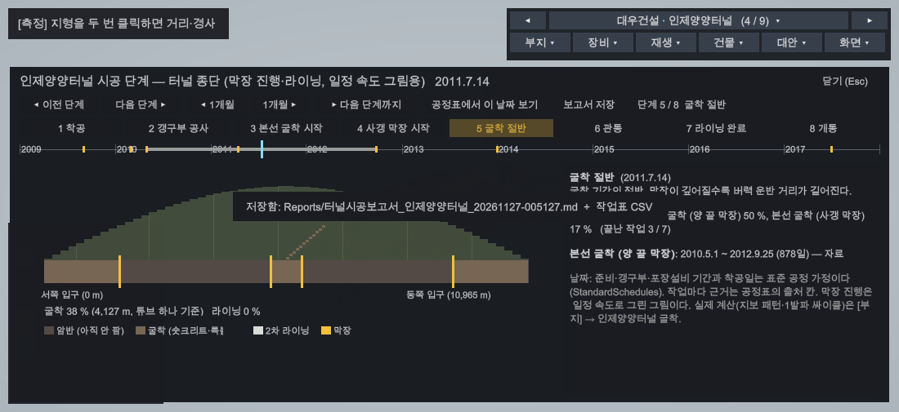 | 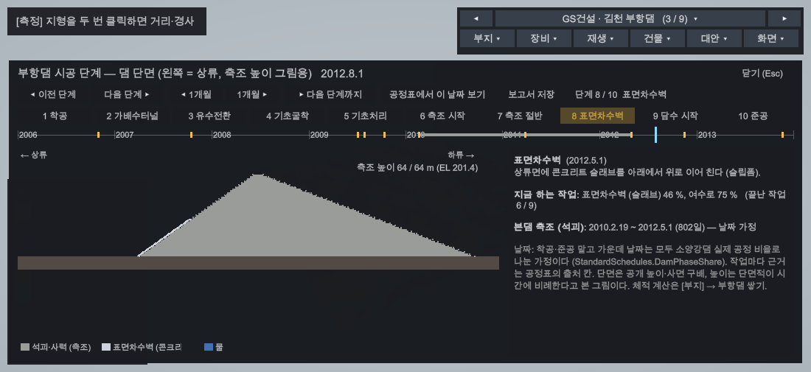 | 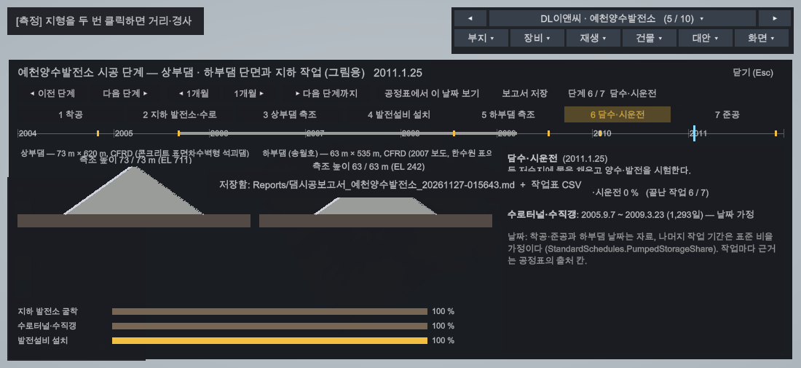 |

## 랜드마크: 인천대교 (8개 회사가 아닌 곳에 지원할 때)

현장 목록 9번 **랜드마크 · 인천대교 (사장교)**. 2005.7 착공 ~ 2009.10 준공 (국토교통부), 주시공 삼성물산 JV.

- **노선:** 위성 지형은 바다를 0 m로 평평하게 처리해 상판이 보이지 않아, OpenStreetMap의 인천대교고속도로(영종 → 송도)를 썼습니다. OSM에서 사장교로 표시된 구간이 **1,482 m**로 공개 값 1,480 m와 0.1 % 차이라, 그 서쪽 끝을 기준으로 국토교통부 구간 연장을 놓았습니다.
- **구간:** 서측 고가교 5,950 m(FSLM, 50 m 경간 통째 프리캐스트) · 서측 접속교 889 m(프리캐스트 FCM, 최대 145 m) · **사장교 1,480 m (80 + 260 + 800 + 260 + 80, 주탑 238.5 m, 선박 통과 74 m)** · 동측 접속교 889 m · 동측 고가교 2,450 m.
- **공정:** 중간 날짜 자료가 없어 표준 시공 속도(가정)로 계산했습니다 — 주탑 올림(238.5 ÷ 4 m) × 7일 = 420일, 사장교 상판 올림(400 ÷ 12 m) × 7일 + 키 세그먼트 14일 = 252일, FSLM 1경간 2일. **주공정은 주탑 기초 → 주탑 → 사장교 상판**이고, 이 속도로는 2008.9.25에 끝나 실제 준공보다 371일, 상판 완료(자료 2009.6.22)보다 390일 빠릅니다. 어느 작업이 더 걸렸는지는 자료가 없어 정하지 않았습니다.
- **3D:** 단계 화면의 [3D로 보기]로 실제 노선 위에 그날 다 된 상판·교각·역Y 주탑·케이블(60 m 간격, 그림용)을 봅니다.

| 네트워크 공정표 (논리 1,182일 ↔ 실제 1,553일) | 측면도: 주탑에서 상판 내밀기 |
|---|---|
| 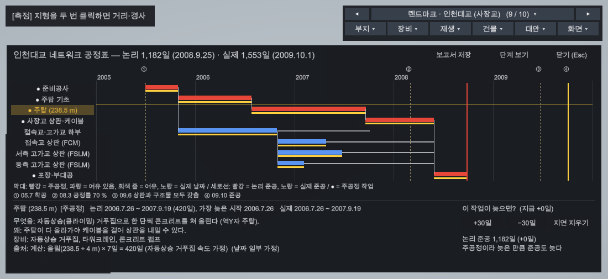 | 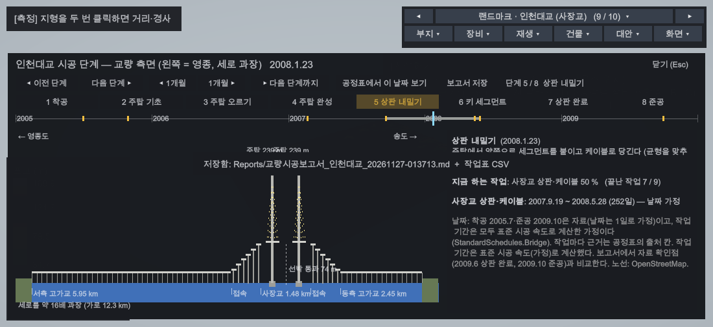 |

| 3D: 상판 내밀기 (2008.1) | 3D: 준공 |
|---|---|
| 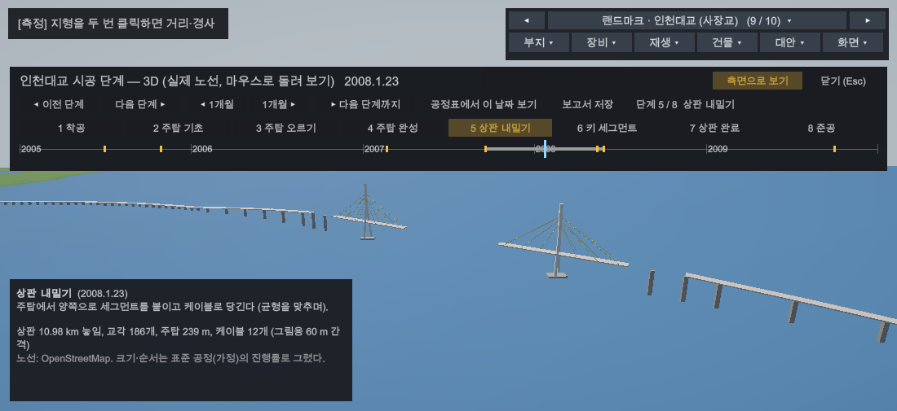 | 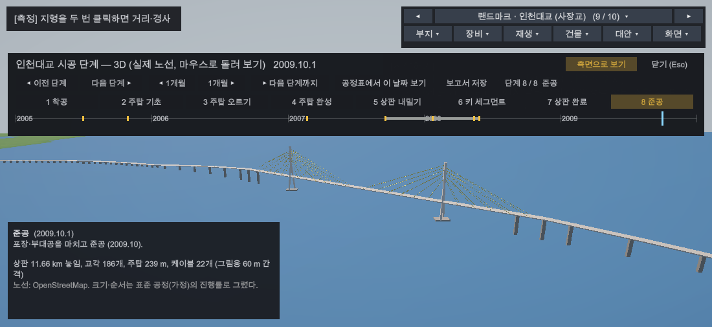 |

## 회사가 만든 구조물 (자세히)

현장을 고른 이유가 "그 회사가 시공한 구조물"이므로, 댐 현장에서는 메뉴 **[부지] → ○○댐 쌓기**로 공개 제원대로 댐을 쌓아 봅니다. 기존 토공 계산(체적, 토량 균형, 장비 공기, 4D, 대안 비교, 보고서)을 그대로 댐에 씁니다. 댐마다 다른 것은 자료 묶음(`Core/SiteStructures.cs`의 `DamSpec`) 하나뿐입니다.

### ① 현대건설 소양강댐 (중앙차수벽형 사력댐, 1967 ~ 1973)

| 완공 (댐 상류는 지금 수면 높이의 물) | 공사 전 계곡 (복원) |
|---|---|
| 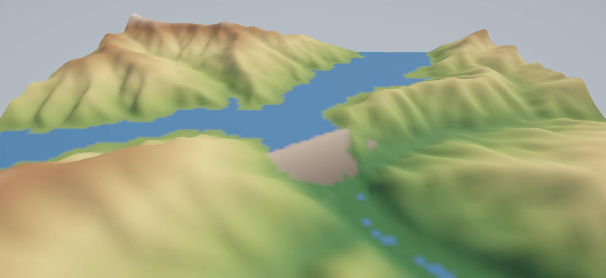 | 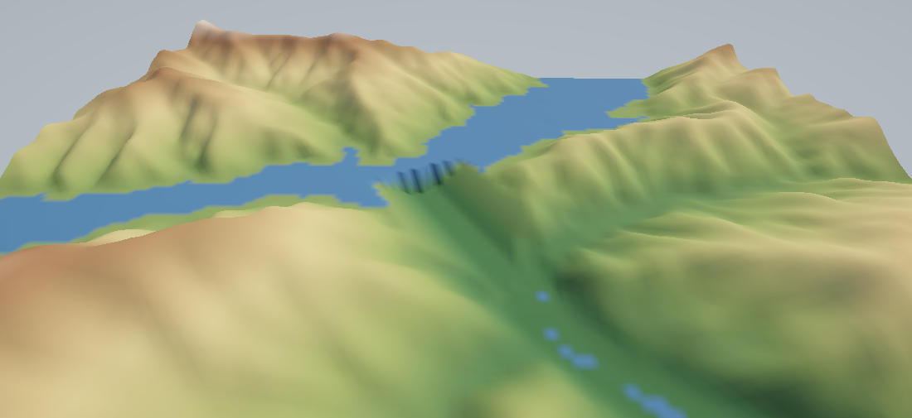 |

- **단면:** 마루 EL 203 m, 높이 123 m, 길이 530 m, 사면 상류 1:2.3 · 하류 1:2.0 (한국댐협회, K-water연구원 2013). 마루폭 11 m는 공개 자료에 없어 저폭 540 m에서 역산했습니다.
- **공사 전 계곡을 어떻게 아나:** 위성 지형에는 이미 댐과 호수가 있습니다. 댐 밖 북쪽 양안의 자연 사면에 직선을 맞추고(1:1.76), 남쪽은 같은 기울기로 대칭, 바닥은 기초 EL 80 m(= 203 − 123)로 놓았습니다.
- **결과:** 계산 체적 **9,395,915 m³**, 공개 체적 9,591,200 m³와 **−2.0 %**. 같은 계산을 사다리꼴 계곡 시험(정답 741,666.67 m³)에도 돌려 격자 오차 +0.11 %를 확인했습니다.
- **실제 공기와 비교:** 실제 공사는 1967.4.15 ~ 1973.10.15 (2,375일, 여수로·발전소 포함). 굴착기 4대 + 트럭 8대로는 토공만 8,024일이라, 쉬는 날 없이 일해도 장비가 3.4배 이상 필요하다는 것이 나옵니다.
- **한계:** 재료를 한 가지(사력, 표준품셈 "역" L 1.15 · C 1.075)로 봤습니다 (실제는 코어·필터·사력·암 존). 30 m 격자라 마루 능선이 198.7 m로 낮게 보이고, 호수 바닥 지형이 없어 공사 전 화면에서 댐 상류 띠 끝에 단차가 보입니다. 댐에서는 건물이 없으므로 전체 공기 = 토공 공기입니다.

### ② GS건설 김천 부항댐 (표면차수벽형 석괴댐, 2006 ~ 2013)

| 완공 | 공사 전 계곡 (복원) | 쌓는 중 |
|---|---|---|
| 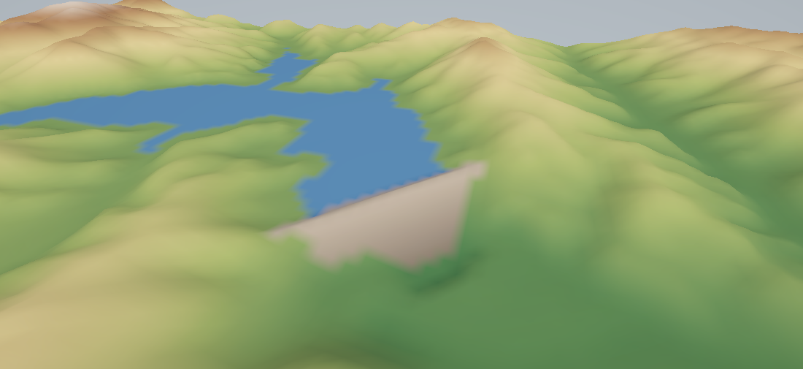 | 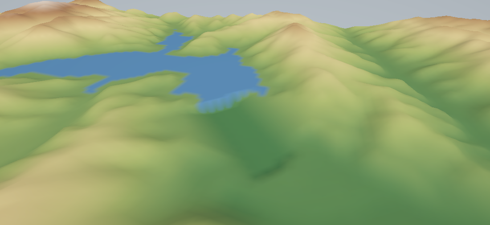 | 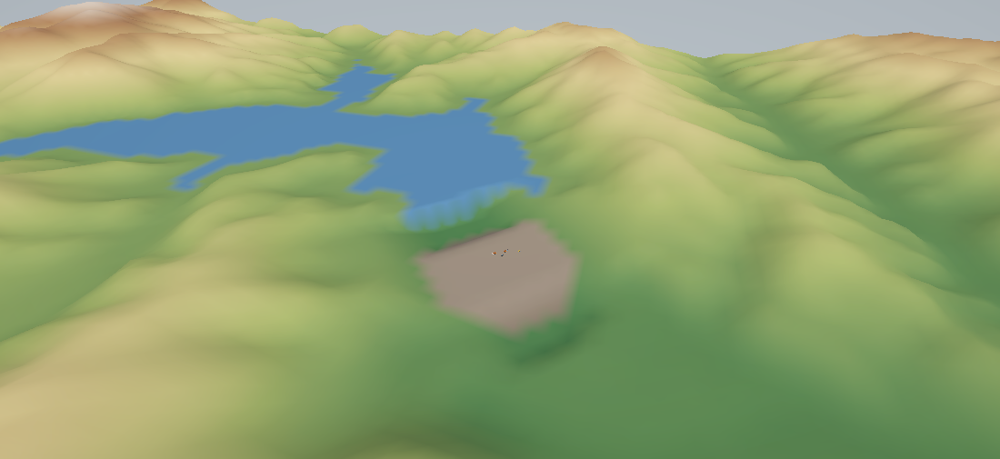 |

- **시공사 확인:** K-water 2009년 감사결과보고서에 "시공사: GS건설(본댐)"이라고 적혀 있습니다(설계·시공 일괄입찰). 같은 보고서에 이 댐이 하상 사력재를 주 축조존(3B, 다짐 두께 60 cm)에 쓴 표면차수벽형 댐이라는 내용이 있습니다.
- **공개 제원 (K-water):** 마루 EL 201.4 m, 높이 64 m, 길이 472 m, 체적 2,162,000 m³.
- **사면 구배는 공개 자료에서 찾지 못했습니다.** 그래서 이렇게 정했습니다.
  - 하류: 위성 지형에서 잰 1:2.72를 소양강댐으로 보정해 **1:2.6**으로 했습니다. 위성에서 사면을 재는 함수(`DamSlopeSurvey`)를 소양강댐에 먼저 써 보면 1:2.06이 나와, 공개 1:2.0과 3 % 차이였습니다.
  - 상류 1:1.4와 마루폭 8 m는 **가정**입니다. 상류면은 물에 잠겨 위성으로 잴 수 없습니다.
- **결과:** 계산 체적 **2,326,422 m³**로, 공개 체적보다 **+7.6 %** 큽니다. 가정을 바꿔 보면(상류 1:1.3 ~ 1:1.5, 하류 1:2.5 ~ 1:2.7, 마루폭 6 ~ 10 m) +5 ~ +10 %라서, 공개 구배를 쓴 소양강댐(−2.0 %)보다 불확실합니다.
  - 남은 차이의 후보: 기초 EL 137.4 m(= 201.4 − 64)를 계곡 바닥 전체에 적용했습니다. 위성의 하천 바닥은 약 151 m입니다 (검증되지 않음).
- **실제 공기와 비교:** 실제 사업은 2006.11 ~ 2013.11 준공식(2,576일)입니다. 굴착기 4대 + 트럭 8대로는 토공 1,987일이라, 쉬는 날 없이 일하면 실제 기간 안에 듭니다. 장비가 3.4배 이상 모자라던 소양강댐과 반대입니다.

### ③ 대우건설 인제양양터널 (NATM 도로터널, 2010 ~ 2012 굴착)

인제양양터널 현장에서 **[부지] → 인제양양터널 굴착 (NATM)**을 누르면 터널 굴착 공정을 재생합니다. 터널은 땅속이라, 지형 위에는 터널 평면 위치를 띠로 그리고 아래에는 종단면을 함께 보여 줍니다. 띠와 종단면에서 판 곳은 지보 패턴 색으로, 지금 파는 막장은 노란 기둥으로 표시합니다.

| 굴착 중 (522일째, 막장 4개) | 종단면과 글상자 |
|---|---|
| 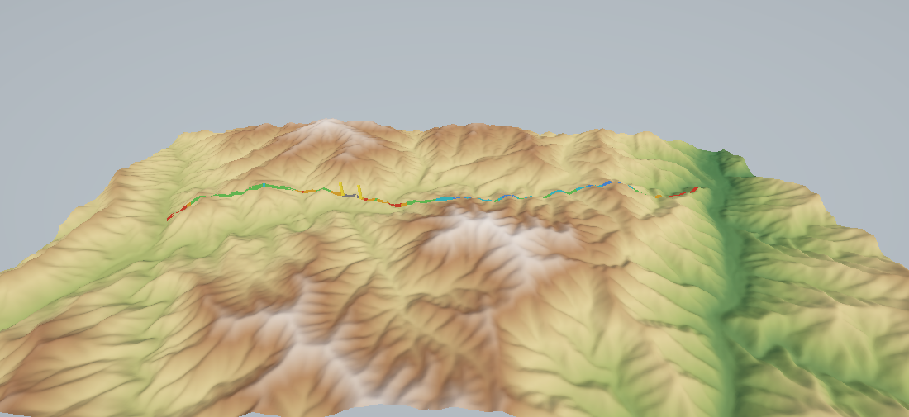 | 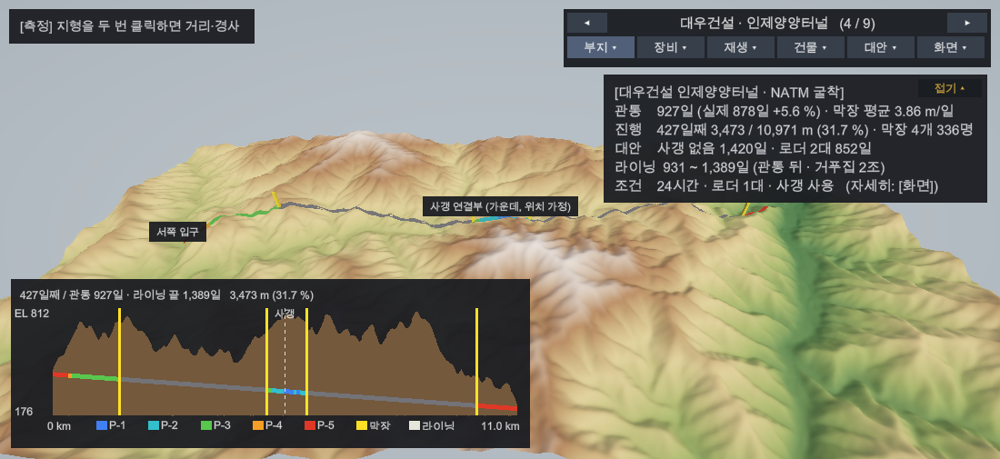 |

- **자료:**
  - 길이 10,965 m, 2차로 튜브 2개입니다. 2010년 5월 굴착을 시작해 2012년 9월 25일 관통했습니다.
  - 하루 평균 약 25 m를 팠고, 반출한 토석은 196만 m³입니다.
  - 양 끝 입구와 가운데 사갱에서 "네 방향 동시 굴착"을 했습니다.
  - 시공은 대우건설 등 5개사 컨소시엄입니다 (국민일보·폴리뉴스 보도).
  - 평면 선형은 OpenStreetMap 튜브 2개(© OpenStreetMap contributors)를 좌표 변환해 썼습니다. 변환 후 길이는 10,971 m로 공식 길이와 0.06 % 차이입니다.
- **1발파 사이클 = 표준품셈 토목 3-2-1 "터널굴착 1발파당 싸이클 시간" C군(2차로 이상):**
  - 고정 작업 시간: 천공준비 30분, 장약·발파 55분, 환기 27.5분, 부석제거 45분 등
  - 물량으로 계산하는 시간:
    - 천공: 점보드릴 3붐, 천공 속도는 3-2-3에서 가져옴
    - 버력처리: 로더 5.0 m³, 작업량은 8-2-5 식으로 계산
    - 숏크리트·록볼트: 각 패턴의 두께·개수로 계산
- **지보 패턴과 단면:** 한국도로공사 표준 패턴 P-1 ~ P-5를 썼습니다. 굴진장은 4.0 / 4.0 / 2.5 / 1.5 / 1.2 m입니다. 굴착 단면적은 90 m²입니다.
  - 지질 자료가 없어, 2014년 고속도로 터널 107곳의 실제 시공 비율(P-3 36.6 % 등)을 썼습니다.
  - 위성 지형에서 구한 토피가 얕은 곳부터 나쁜 패턴을 배정했습니다. 그래서 입구 쪽은 P-5입니다.
  - 토피는 최대 525 m로, 보도된 "200 ~ 550 m 아래"와 맞습니다.
- **결과 (하루 24시간 작업, 막장 4개, 사갱 막장은 348일째부터):**
  - 막장 평균 하루 3.86 m → 관통 **927일**로, 실제 878일과 **+5.6 %** 차이입니다.
  - 두 튜브를 합친 하루 굴착은 23.7 m로, 보도된 약 25 m보다 조금 느립니다.
  - 처음에는 P-4·P-5의 상하반 분할 굴착을 전단면처럼 계산해서 847일(−3.5 %)이었습니다. 표준품셈 3-2-1 주 ⑤의 하반 싸이클(작업마다 65 % 또는 100 %)을 넣고 나서 927일이 되었습니다. 실제와 차이는 커졌지만, 실제 값에 맞추려고 계수를 바꾸지는 않았습니다.
  - 설계 단면으로 판 양은 1,974,775 m³로, 보도된 토석 196만 m³와 +0.8 % 차이입니다.
- **대안:**
  - 사갱이 없었다면 막장 2개로 **1,420일(+493일)**이 걸립니다. 사갱을 판 이유가 숫자로 나옵니다.
  - 좋은 암반에서는 버력처리(로더)가 사이클에서 가장 길어서(P-1 313분), 로더를 2대로 늘리면 852일(−75일)입니다.
  - **위험 시나리오:** 표준품셈 3-2-1 주 ⑦은 용수(지하수) 때문에 굴착이 지장을 받으면 싸이클을 30 %까지 늘리게 합니다. 전 구간에 +30 %를 주면 관통 1,153일(+226일)입니다. [장비] → 용수에서 바꿀 수 있고, 싸이클 내역에 "용수 할증" 줄로 보입니다.
- **버력 운반:** 막장이 깊어질수록 버력을 실어 나르는 거리가 길어집니다. 그래서 로더가 기다리지 않게 하려면 덤프트럭이 더 필요합니다.
  - 표준품셈 8-2-8 적재기계 사용 시 식으로 계산하면, 입구 근처는 3대, 깊이 5 km에서는 11대가 필요합니다.
  - 터널 안 주행속도와 사토장까지의 거리는 가정입니다.
- **단면 모식도 (학습용):** [화면] → 터널 단면 모식도 켜기(또는 자세히)를 하면 왼쪽에 서쪽 막장 위치의 지보 패턴 단면이 나옵니다.
  - 숏크리트(회색, 두께 5배로 과장), 록볼트(노랑, 길이·간격 그대로), 강지보(파랑), 상하반 경계(흰 점선), 라이닝을 쳤으면 안쪽 흰 띠.
  - 모양은 반지름 6 m 아치 + 측벽의 단순한 말굽형이고, 면적만 90 m²로 맞춘 모식도입니다.

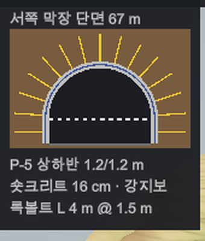

- **작업 인원:** 표준품셈 3-2-5 "터널굴착 1발파당 작업인원" C군은 막장 하나에 13 ~ 15인입니다 (가운데 14인: 운전원 6, 작업반장 1, 보통인부 3, 특별인부 4, 화약취급공 1).
  - 24시간을 8시간 3교대로 보면, 막장 4개 × 튜브 2개가 모두 팔 때 336명이 터널 굴착에 붙습니다.
  - 굴착 연인원은 238,539인·일입니다. 같은 속도로 같은 길이를 파면 사갱이 있어도 연인원은 같고, 기간만 줄어듭니다.
  - 교대 방식과 버력 트럭 기사·설비 인원은 넣지 않았습니다.
- **지보재 물량:** 패턴마다 1 m당 숏크리트·록볼트·강지보를 계산하고 패턴 길이를 곱합니다. 인제양양터널 두 튜브는 숏크리트 60,251 m³, 록볼트 223,785개, 강지보 5,762개입니다.
  - 예: P-3 숏크리트 = 둘레 28 m × 9 cm = 2.52 m³/m, 록볼트 = 28 ÷ 1.5² = 12.4개/m.
  - 재생 중에는 그날까지 판 구간의 양이 글상자(자세히)에 나옵니다. 여굴 채움·2차 라이닝은 넣지 않았고, 실제 물량 자료와는 대조하지 못했습니다.
- **2차 라이닝:** 표준품셈 토목 3-3-1 "터널 철재거푸집 설치·해체·이동"은 거푸집 1 span을 치는 데 1일입니다.
  - 관통 뒤 방수 작업대차 조립 4일(3-4-2) → 튜브마다 거푸집 2조가 양 입구에서 하루 12 m씩 들어갑니다 → 인제양양터널은 1,389일째(2014.2)에 끝납니다 (실제 개통 2017.6보다 앞).
  - 재생은 라이닝이 끝날 때까지 이어지고, 친 곳은 콘크리트 색으로 바뀝니다. 종단면의 흰 짧은 기둥이 지금 치고 있는 거푸집입니다. [장비]에서 거푸집을 1·2·4조로 바꿀 수 있습니다 (1조 1,846일, 4조 1,160일).
  - 콘크리트 184,312 m³, 방수 614,374 m², 라이닝을 따라가려면 방수공이 하루 14.8명 필요합니다(3-4-1 m²당 0.011인).
  - **대안: 굴착과 병행.** 강재 거푸집 아래로 버력 트럭이 지나갈 수 있어서, 실무에서는 막장 뒤에서 라이닝을 함께 치기도 합니다.
    - 거푸집이 막장에서 500 m(가정) 뒤까지만 치게 하면 204일째부터 시작해 1,141일째(2013.6)에 끝납니다. 관통 뒤에 시작할 때보다 248일 빠릅니다.
    - 막장이 하루 4 ~ 5 m로 거푸집(하루 12 m)보다 느려서, 관통 전에는 거푸집이 막장을 따라가며 기다립니다.
    - 갱내 운반·환기 간섭으로 굴진이 느려지는 것은 넣지 않았습니다.
  - span 길이 12 m와 두께 30 cm는 가정이고, 실제 라이닝 기간 자료는 찾지 못했습니다.

| 관통 뒤 라이닝 (흰색 = 라이닝) | 굴착과 병행 (막장 500 m 뒤) |
|---|---|
| 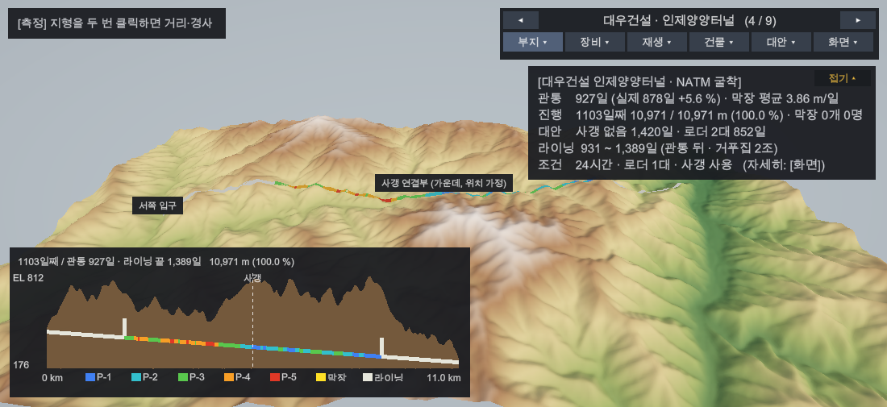 | 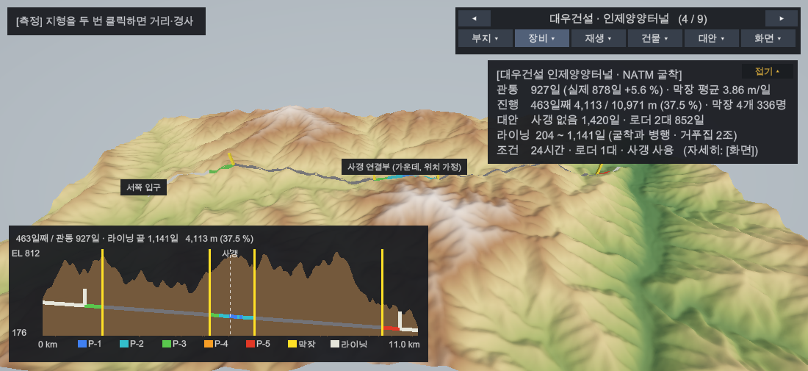 |

- **터널 보고서:** 터널 보기 중 **[대안] → 보고서 저장**을 누르면 한 문서로 저장됩니다.
  - 들어가는 내용: 패턴별 사이클, P-3 사이클 내역, 막장 공정과 누적 굴진표, 대안, 지보재 물량, 2차 라이닝과 방수, 버력 트럭, 가정과 출처
  - 조건 조합표: 하루 작업 시간 16·20·24시간 × 로더 1·2대 × 사갱 유무별 관통 일수

| 사갱이 없을 때 (막장 2개, 관통 1,420일) |
|---|
| 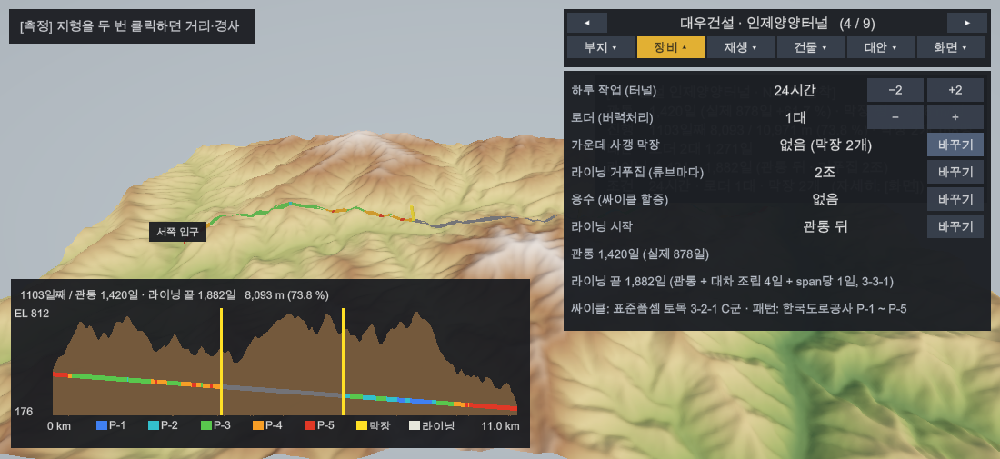 |

- **한계 (가정):**
  - 발파공 수(1.6공/m²), 발파 효율 90 %, 숏크리트 기계 능력과 반발 손실, 단면 둘레는 가정입니다.
  - 지보 패턴은 토피 순서로 배정했습니다. 실제로는 막장 관찰과 RMR로 정합니다.
  - 상하반 분할 굴착(P-4, P-5)은 상반과 하반 싸이클을 같은 조가 번갈아 한다고 보고 더했습니다. 상반 면적 60 %는 가정입니다 (55 ~ 65 %로 바꿔도 결과가 거의 같습니다).
  - 용수·고장·작업 중단은 넣지 않았습니다.
  - 하루 24시간 작업이라고 봤습니다. 20시간으로 계산하면 982일이 나옵니다.
  - 30 m 위성 지형이라 입구 근처를 가까이서 보면 거칩니다.

### ④ 포스코이앤씨 부산 산성터널 (NATM, 2016 관통)

| 굴착 중 (226일째, 양 끝 막장 2개) |
|---|
| 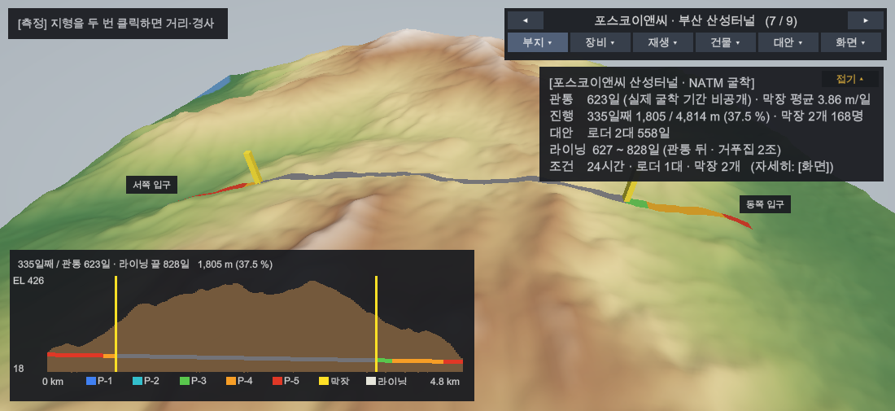 |

- **자료 (포스코 뉴스룸 2016-10-13):**
  - 포스코건설 컨소시엄이 4.87 km 터널을 포함해 도로 5.62 km를 시공했습니다.
  - NATM 공법이고, 공사 기간은 2013.8 ~ 2018.9, 총공사비는 1,925억 원입니다.
  - 주거지·학교가 가까워 발파 진동 관리가 어려웠다고 적혀 있습니다.
  - 평면 선형은 OpenStreetMap의 2차로 튜브 2개를 썼고, 길이는 4,814 m입니다.
- **인제양양터널과 같은 계산입니다.** 다만 굴착 시작일과 작업구(사갱) 자료가 공개되어 있지 않습니다.
  - 그래서 막장은 양 끝 2개로 가정했습니다. 계산 결과 관통은 623일입니다.
  - 확인되는 기간은 착공부터 관통 보도까지 1,169일뿐입니다. 이 기간에는 굴착이 아닌 기간이 들어 있어서, 계산과 % 비교를 하지 않았습니다.
- 컨소시엄에서 포스코가 맡은 지분과 주간사 여부는 확인하지 못했습니다.

### ⑤ 롯데건설 청계산3터널 · HDC현대산업개발 미사터널 (NATM)

| 청계산3터널 (제2경인 안양~성남, 2,770 / 2,734 m) | 미사터널 (서울~춘천, 2,163 / 2,181 m) |
|---|---|
| 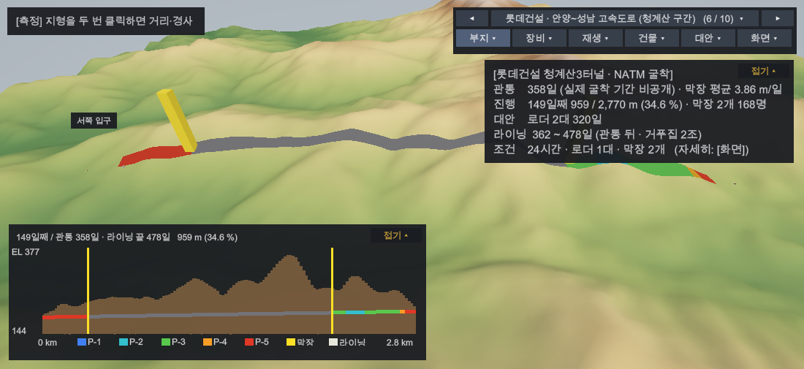 | 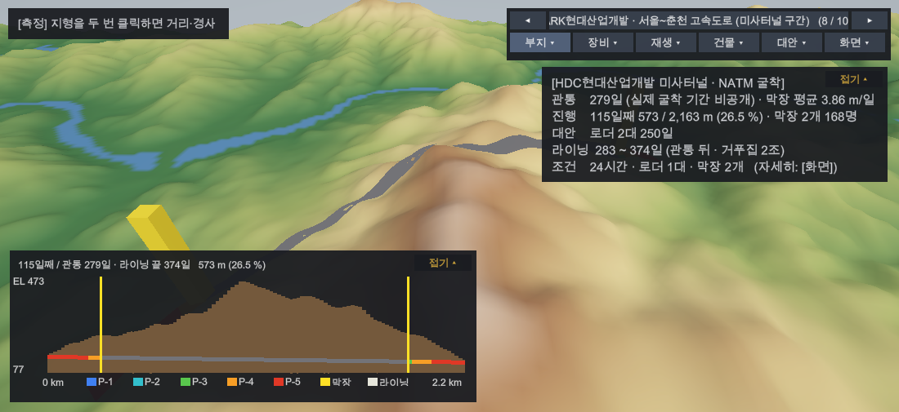 |

- **선형:** OpenStreetMap의 `tunnel:name` 청계산3터널 · 미사터널 두 튜브 (미사터널은 HDC 토목 실적 "미사터널 외 2,200 NATM"과 길이가 맞습니다). 입구 노면은 위성 지형에서 잼.
- **날짜:** 안양~성남 착공 2012.6.1 (경기일보) · 개통 2017.9.27 (OSM), 서울~춘천 착공 2004.8 (머니투데이) · 개통 2009.7.15 (Korea Times). **굴착 시작일·관통일은 공개되지 않아** 비교하지 않습니다.
- **계산:** 인제양양과 같은 표준품셈 1발파 싸이클 · 지보 패턴. 양 끝 막장 2개로 관통 청계산3 358일, 미사 279일.

### ⑥ 삼성물산 청송양수 · DL이앤씨 예천양수 (순양수식 발전소)

- **양수발전소는 댐 하나가 아닙니다:** 산 위 상부댐 + 산 아래 하부댐 + 두 저수지를 잇는 수로터널·수직갱 + 지하 발전소 + 펌프수차·발전전동기. 그래서 공정표에 일곱 작업을 두고, 주공정은 **준비 → 지하 발전소 굴착 → 발전설비 → 시운전**입니다 (두 댐은 여유).
- **제원 (한국수력원자력):** 청송 상부댐 89.8 m × 400 m(230만 m³) · 하부댐 62 m × 300 m(70.7만 m³), 600 MW, 준공 2006.12 / 예천 CFRD 상부댐 73 m × 620 m(EL 711, 222만 m³) · 하부댐 63 m × 535 m(EL 242, 205만 m³), 800 MW, 공사 2004.11 ~ 2011.12 (대림산업·삼환기업·풍림산업).
- **한계:** 청송은 댐 형식을 공개 자료에서 찾지 못했습니다. 예천 하부댐(2009.9 ~ 2010.6 축조, 2010.8 담수) 말고는 작업 기간이 표준 비율 가정입니다.

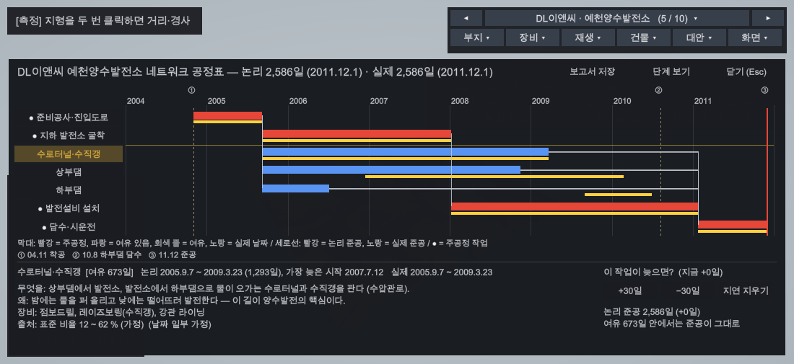

## 예시: 굴착기를 두 배로 늘리면?

같은 현장에서 조건 세 가지를 저장해 비교한 결과입니다. 메뉴 **[대안] → 예시 불러오기**를 누르면 이 비교(소양강댐, 균형 계획고, A·B·C)가 버튼 하나로 그대로 만들어집니다.

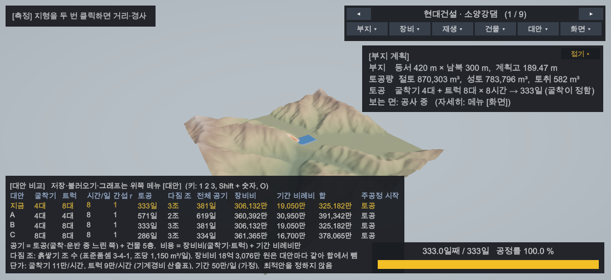

| 대안 | 굴착기 | 덤프트럭 | 토공 | 전체 공기 | 비교용 비용 |
|---|---|---|---|---|---|
| A | 4대 | 4대 | 571일 (운반이 느림) | 619일 | 39억 1,342만 원 |
| B | 4대 | 8대 | 333일 (굴착이 정함) | 381일 | 32억 5,182만 원 |
| C | **8대** | 8대 | 286일 (운반이 느림) | 334일 | 37억 8,065만 원 |

- **A → B:** 트럭만 4대 늘렸는데 공기가 238일 줄고 비용도 줄었습니다. A에서는 굴착기가 트럭을 기다리고 있었습니다.
- **B → C:** 굴착기를 두 배로 늘렸지만 공기는 47일만 줄었습니다. 굴착은 166일이면 끝나지만 트럭 8대로는 운반에 285일이 걸리기 때문입니다.
- **다짐 조:** 실어 온 흙은 펴고 다져야 합니다. 표준품셈 2025에 새로 생긴 흙쌓기 품(3-4-1)은 한 조(진동롤러 10 t, 모터그레이더, 굴착기 0.6 m³, 살수차 0.5대)가 30 cm 다짐을 하루 1,150 m³ 한다고 정합니다. 성토 783,774 m³를 토공 기간 안에 다지려면 A는 2조, B·C는 3조가 필요합니다. 흙쌓기 장비비(약 18억 3천만 원)는 성토량에만 비례해 대안마다 같으므로 비교용 합계에서 뺐습니다.

장비는 대수가 아니라 **조합**으로 계획해야 한다는 것을 숫자로 보여 줍니다. 아래 그래프는 트럭 8대로 고정하고 굴착기를 1 ~ 12대로 바꾼 결과입니다. 5대부터는 공기가 더 줄지 않습니다.

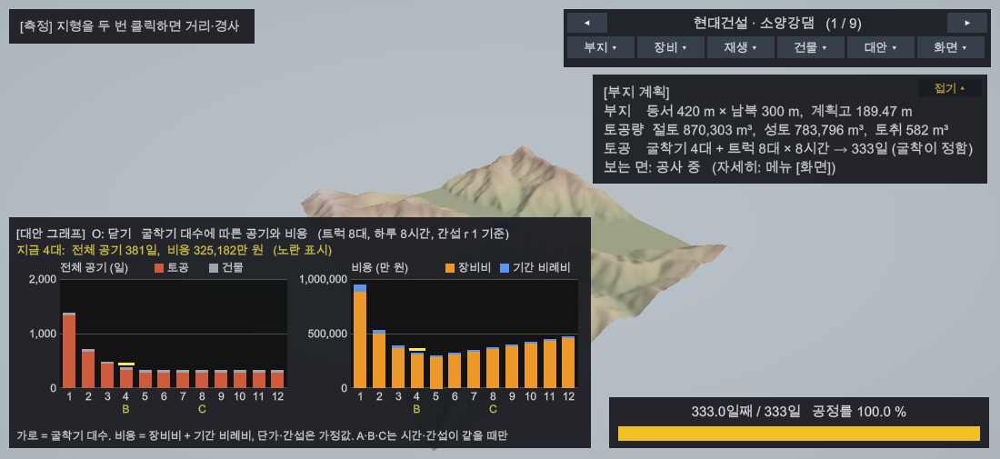

메뉴 **[대안] → 보고서 저장**을 누르면 부지·토공량·장비·CPM 공정표·대안 비교를 한 문서(Markdown)와 대안 표(CSV, 엑셀용)로 저장합니다. 보고서에는 계산 결과를 풀어 쓴 **자동 문장**이 들어갑니다. 위 예시로 만든 보고서: [Docs/examples/report-soyanggang.md](Docs/examples/report-soyanggang.md)

> A → B (덤프트럭 4대 → 8대): 전체 공기는 619일 → 381일(238일 단축), 비교용 비용은 39억 1,342만 원 → 32억 5,182만 원(6억 6,159만 원 감소)이다. 토공 공기를 정하는 쪽이 운반에서 굴착으로 바뀌었다.

자동 문장은 계산된 숫자와 계산 안에 있는 사실(토공을 정하는 쪽, 주공정선의 시작)만 풀어 쓰고, 새 판단을 더하지 않습니다.

> [!IMPORTANT]
> 비용은 굴착기·덤프트럭 장비비와 기간 비례비만 더한 **비교용 일부 항목**입니다. 대안마다 같은 흙쌓기 장비비는 표 아래에 따로 적습니다. 장비 단가는 「건설기계의 기계경비 산출표」와 시중노임단가·경유 가격으로 계산했고(굴착기 약 10.7만 원/시간, 덤프트럭 약 9.0만 원/시간), 기간 비례비(50만 원/일)는 가정값입니다. 프로그램은 어느 대안이 "최적"이라고 정하지 않고, 숫자를 나란히 보여 줍니다.

## 계산을 어떻게 검증했나

계산 코드(`Core`)는 Unity에 의존하지 않는 순수 C#이라 화면 없이 자동 테스트로 검증합니다. 테스트마다 손계산 과정을 주석으로 적었습니다.

| 계산 | 방법 | 손계산 예 |
|---|---|---|
| 토공량 | 삼각형 점고법. 절토·성토가 섞인 삼각형은 0이 되는 선으로 나눈다 | 평지 부지 40 × 20 m, 깊이 10 m, 구배 1:1.0 → 15,042.89 m³ (원뿔 모퉁이 정해와 0.03 % 차이) |
| 토량 균형 | 자연·흐트러진·다져진 상태 구분, 사토·토취 | 절토 10,000, 성토 4,000, L 1.25, C 0.9 → 사토 5,555.6 m³ |
| 균형 계획고 | 이분법 40회 | 10 % 경사면, C 0.9 → 10√0.9 / (1 + √0.9) = 4.868 m |
| 굴착기 | Q = 3600·q·k·f·E / cm (표준품셈 8-2-3) | 1.0 m³, K 0.9, f 0.8, E 0.6, 19초 → 81.85 m³/시간 |
| 덤프트럭 | Q = 60·q·f·E / cm, cm = t1 + … + t6 (표준품셈 8-2-8) | 15 t, 교외 포장도로 5 km, 덮개·세륜 포함, 적재 사이클 20초 → 16.52 m³/시간 |
| 터널 1발파 싸이클 | 표준품셈 토목 3-2-1 C군 + 3-2-3 천공속도 + 8-2-5 로더, 패턴은 한국도로공사 P-1 ~ P-5 | P-3: 고정 230분 + 천공 133.3 + 버력 195.9 + 면정리 65.6 + 숏크리트 44.9 + 록볼트 93.3 = 763.1분 → 24시간 4.72 m/일 |
| 터널 지보재 물량 | 패턴별 1 m당 물량 × 패턴 길이 × 튜브 수 | P-3: 숏크리트 28 × 0.09 = 2.52 m³/m, 록볼트 28 ÷ 1.5² = 12.44개/m |
| 터널 2차 라이닝 | 거푸집 span 수 = 올림(맡는 길이 ÷ 12 m), span당 1일 (3-3-1) | 1,000 m, 거푸집 2조 → 500 ÷ 12 = 41.7 → 42일, 관통 100일 + 대차 4일 → 146일 |
| 터널 막장 공정 | 막장마다 위치별 굴진으로 나아가 서로 만나면 멈춤 | 1,000 m를 양 끝 5 m/일 → 100일, 40일째 가운데 막장 2개 추가 → 70일 |
| 흙쌓기(다짐) | 흙쌓기 조 일당 1,150 m³ (표준품셈 3-4-1), 롤러 Q = 1000·V·W·D·E·f / N (8-2-9)로 대조 | 진동롤러 10 t: 1000 × 4.0 × 1.9 × 0.30 × 0.60 / 6 = 228 m³/시간. 성토 783,774 m³ ÷ (1,150 × 333일) = 2.05 → 3조 |
| CPM | 전진·후진 계산, 여유, 주공정선 | A(3) B(4) C(2) D(5) E(3) → 공기 12일, 주공정선 B → D → E |
| 실제 지형 파일 | 읽은 크기·위치·표고를 GDAL 값과 비교 | 소양강댐 지점 197.03 m |

화면에 나온 숫자도 캡처로 손계산과 대조했습니다. 화면 확인은 Unity를 명령줄로 띄워 미리 써 둔 순서대로 키를 누르고 화면과 글상자 내용을 저장하는 자동 시연 도구(`Runtime/ScenarioRunner.cs`)로 합니다.

계수의 출처와 판정(표에 있음 / 고침 / 가정)은 [Docs/ASSUMPTIONS.md](Docs/ASSUMPTIONS.md)에 정리했습니다. 예를 들어 처음 쓴 굴착기 사이클 20초는 표준품셈 표에 없는 값이어서 1.0 m³급·90° 선회 값인 19초로 고쳤습니다.

## 수록한 현장 (8곳 + 랜드마크)

국내 건설사가 시공에 참여한 것으로 자료에서 확인되는 준공 현장 가운데, 지형 기복이 뚜렷한 곳을 골랐습니다.

| 현장 | 시공 참여사 (자료 기준) | 현장 | 시공 참여사 (자료 기준) |
|---|---|---|---|
| 소양강댐 | 현대건설 | 예천양수발전소 | DL이앤씨 |
| 청송양수발전소 | 삼성물산 (공동 시공) | 안양~성남 고속도로 청계산 구간 | 롯데건설 |
| 김천 부항댐 | GS건설 | 부산 산성터널 | 포스코이앤씨 (컨소시엄) |
| 인제양양터널 | 대우건설 | 서울~춘천 고속도로 미사터널 구간 | IPARK현대산업개발 (컨소시엄) |
| **랜드마크: 인천대교** | 삼성물산 JV (주시공) — 어느 회사에 지원하든 보여 줄 교량 | | |

시공사 근거 자료, 확인하지 못한 점, 현장별 검산 값은 [Docs/SITES.md](Docs/SITES.md)에 있습니다.

## 한계

- **지형:** Copernicus DEM GLO-30 (약 30 m 칸, DSM). 건물·나무 높이가 섞여 있고, 좁은 구조물은 평균되어 낮게 나옵니다. 높이 기준은 EGM2008 지오이드입니다.
- **가정값:** 기간 비례비, 건물 공종별 일수, 비탈 구배, 암 굴착 작업 비율(토사의 0.35배), 사토장·토취장 거리, 장비 간섭 식은 출처 확인 전입니다. 화면에도 "가정"으로 표시합니다. 암 0.35배는 표준품셈 굴착기 식에 파쇄암 계수(K 0.55, E 0.45, f 1/1.6)를 넣은 값(0.358배)과 비슷하지만, 이 값은 깬 암을 싣는 작업만이고 깨는 작업(브레이커·발파)은 들어 있지 않습니다. 흙쌓기 비용에는 특별인부 노임이 빠져 있습니다 (원자료 미확인).
- **암 깨기:** 암 굴착 공기는 깨진 암을 싣는 작업(토사의 0.35배)만 봅니다. 깨는 작업은 공기에 넣지 않고, 공기 안에 다 깨려면 대형브레이커가 몇 대 필요한지(표준품셈 8-2-13 보통암 3.4 m³/시간)만 글상자와 보고서에 보여 줍니다. 예: 소양강댐 부지에 암반선 5 m를 넣으면 암 639,424 m³에 브레이커 31대가 필요합니다. 같은 암을 일반발파(표준품셈 3-3-5, 크롤러드릴 0.014 시간/m³)로 깨면 드릴 2대면 됩니다. 진동 제한이 큰 미진동굴착(TYPE-Ⅰ, 0.100 시간/m³)이면 11대입니다. 보고서에 발파 공법 6가지를 모두 적습니다.
- **건물 공종 일수:** 기둥 3일·슬래브 5일(한 층 8일)은 가정입니다. 보고서에 표준품셈(거푸집 6-3-1, 철근 6-2-3, 펌프차 6-1-4)으로 검산한 표를 함께 적습니다 — 한 층 8일은 거푸집 6조·철근 3조(66명)일 때 8.5일과 비슷하고, 4조·2조면 11.3일입니다.
- **단순화:** 암반선은 지표와 나란하다고 보고, 건물은 보·벽·마감이 없는 직사각형 철근콘크리트 건물입니다. 운반로·날씨·휴일은 보지 않습니다. 댐은 재료 한 가지로 봅니다.
- **장비 화면:** 장비 치수와 움직임(관절 각도, 단계 비율, 이동 속도)은 보기용입니다. 공기 계산의 굴착·운반 시간과는 따로 움직입니다.

## 실행 방법

**실행 파일로:** Releases의 `CivilTwin-Windows.zip` → 압축 풀기 → `CivilTwin.exe`. 사용법은 [Docs/MANUAL.md](Docs/MANUAL.md), 메모장용은 zip 안의 `사용설명서.txt`입니다.

**Unity 프로젝트로:**

1. Unity **6000.3.28f1 (6.3 LTS)**로 이 폴더를 엽니다.
2. `Assets/Scenes/SampleScene`을 열고 ▶를 누릅니다.
3. 지형 파일이 없으면 수식으로 만든 시험용 언덕이 나옵니다.

**실행 파일(Unity 없이):** Unity 창을 닫은 상태에서 아래 명령을 실행하면 `Builds\Windows\CivilTwin.exe`가 만들어집니다 (`Assets/CivilTwin/Editor/BuildWindows.cs`). 지형 파일도 실행 파일 옆 `Data\sites`로 복사됩니다. 그래픽은 DX11을 먼저 쓰고, DX11이 멈추는 PC에서는 `CivilTwin.exe -force-vulkan`으로 엽니다.

```powershell
& "C:\Program Files\Unity\Hub\Editor\6000.3.28f1\Editor\Unity.exe" -batchmode -quit -projectPath C:\Dev\CivilTwin -force-vulkan -executeMethod CivilTwin.EditorTools.BuildWindows.Build -logFile C:\Dev\CivilTwin\Logs\build.log
```

> [!TIP]
> 지형 파일(`Data/sites/*.asc`)은 용량과 이용 조건 때문에 저장소에 넣지 않았습니다. [Docs/SITES.md](Docs/SITES.md)의 방법대로 QGIS에 포함된 GDAL 명령으로 다시 만들 수 있습니다.

> [!WARNING]
> 개발 PC(Radeon RX 570, 2019년 드라이버)에서는 DX11로 열면 셰이더 컴파일 중 크래시가 나서 `-force-vulkan` 인수로 실행합니다. 자세한 내용은 [Docs/TROUBLESHOOTING.md](Docs/TROUBLESHOOTING.md).

### 조작

화면 오른쪽 위 메뉴의 **[부지] [장비] [재생] [건물] [대안] [화면]**을 누르면 그 아래에 버튼이 펼쳐집니다. 키를 몰라도 버튼만으로 모든 조작을 할 수 있고, 버튼 이름 옆 괄호에 같은 일을 하는 키가 적혀 있습니다.

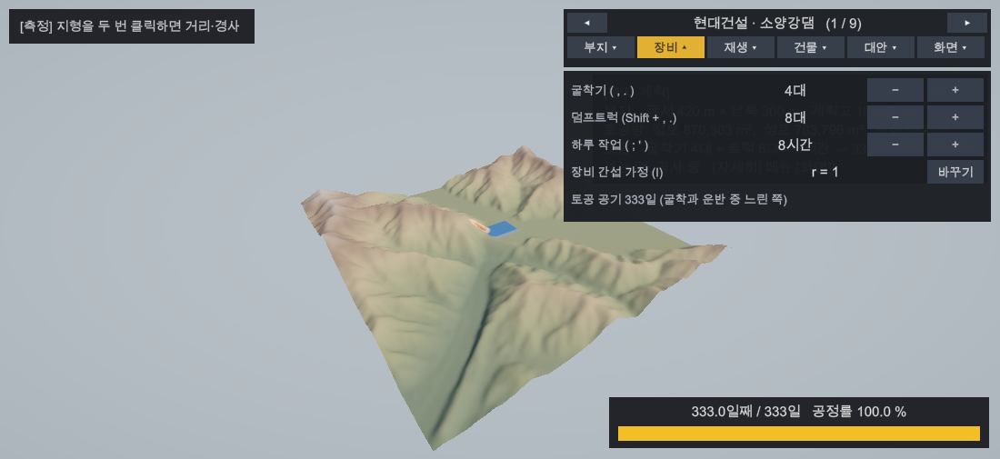

*[장비] 메뉴: 굴착기·덤프트럭 대수, 하루 작업 시간, 간섭 가정을 버튼으로 바꾸면 오른쪽 부지 글상자의 공기가 바로 다시 계산됩니다.*

키로도 같은 일을 할 수 있습니다.

| 키 | 동작 | 키 | 동작 |
|---|---|---|---|
| 드래그 / 휠 / WASD | 회전·이동 / 확대 / 이동 | `[` `]` | 이전·다음 현장 |
| 클릭 | 두 점 측정 | `G` | 커서 위치에 부지 놓기 |
| `−` `=` | 계획고 ∓1 m (Shift 10 m) | `E` | 균형 계획고 |
| `9` `0` | 부지 크기 | `X` | 암반선 깊이 (없음 → 1 → 2 → 5 → 10 → 20 m) |
| `,` `.` | 굴착기 대수 | `Shift` + `,` `.` | 덤프트럭 대수 |
| `;` `'` | 하루 작업 시간 | `I` | 장비 간섭 가정 |
| `Space` / `N` `M` / `B` | 재생 / 하루 앞뒤 / 처음 | `V` | 계획면 · 원지반 · 공사 중 |
| `T` / `F` / `P` | 건물과 장비 / 가까이 / 공정표 | `K` `L` | 층수 |
| `1` `2` `3` / `Shift` + 숫자 | 대안 저장 / 불러오기 | `O` | 대안 비교표 → 그래프 |
| `Tab` | 글상자 켜기·끄기 | `F12` | 화면 저장 |
| `F1` | 키 안내 (화면 가운데, Esc로 닫기) | | |

**재생 속도:** [재생] → 재생 속도 느리게·빠르게 (× 0.5 · 1 · 2 · 4, 토공·건물·터널 공통, 기억).

**현장 목록:** 메뉴의 현장 이름을 누르면 현장 8곳, 랜드마크 인천대교, 시험용 수식 언덕이 펼쳐지고 바로 고를 수 있습니다 (댐·터널 모드가 있는 현장은 [댐]·[터널] 표시). ◀ ▶와 `[` `]`도 그대로 됩니다.

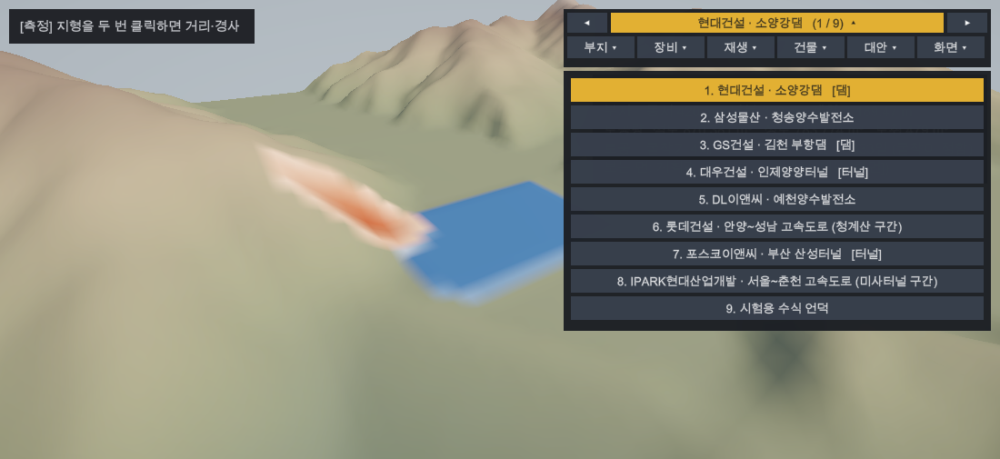

**오른쪽 정보 글상자:** 메뉴 바로 아래에 붙고 폭은 화면의 45 %까지라 지형 가운데를 덮지 않습니다. 오른쪽 위 **[접기 ▴]**를 누르면 핵심 숫자 한 줄만 남습니다. 왼쪽의 건물 글상자, 대안 비교표, 터널 종단면에도 같은 버튼이 있습니다 (비교표는 "지금 381일 · A 619일 · B 381일 · C 334일" 한 줄).

**화면 항목 켜기·끄기:** [화면] 메뉴에서 정보 글상자, 측정 안내, 표고 범례, 누적 토공 그래프, 터널 단면 모식도, 이름표, 시간 막대·종단면을 하나씩 켜고 끌 수 있습니다. 대안 비교표도 여기서 닫을 수 있습니다. **글자 크기**(작게 0.85 · 보통 · 크게 1.25 · 아주 크게 1.5)도 바꿀 수 있습니다 — 창이 작으면 화면에 맞는 크기까지만 커집니다. 고른 설정은 다음 실행에도 남고, **처음 상태로**를 누르면 기본 화면으로 돌아갑니다. "자세히"로 바꾸면 누적 그래프와 터널 단면이 함께 켜집니다. `Tab`은 전부 한꺼번에 줄이거나 숨깁니다.

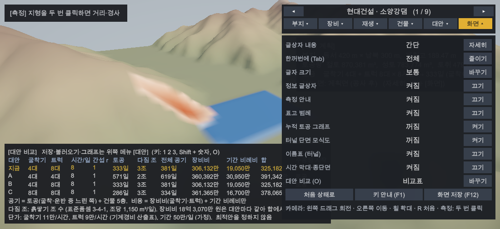

## 구조

```
Assets/CivilTwin/
  Core/      순수 C# 계산 (UnityEngine 의존 없음): 지형, 토공량, 토량 균형, 장비 작업량, CPM, 대안 분석
  Runtime/   Unity 연결: 메시, 카메라, 부지·건물·대안 도구, 화면 글상자, 자동 시연
  Tests/     손계산·GDAL 값과 비교하는 NUnit 테스트 (EditMode)
Tools/Scenarios/  자동 시연 시나리오
Docs/
  MANUAL.md           사용설명서 (사용설명서.txt = 메모장용)
  ABOUT.md            프로그램 한 장 소개
  PROGRESS.md         단계별 진행 기록, 손계산, 화면 검산
  ASSUMPTIONS.md      계산에 쓰는 값과 표준품셈 출처
  SITES.md            현장 선정 근거, DEM 만드는 방법
  TROUBLESHOOTING.md  개발 중 만난 문제와 해결 과정
```

## 개발 방식

- Unity 6.3 LTS, URP, C#, NUnit / QGIS 3.44 (GDAL) / Git
- 코드는 AI 코딩 도구(Claude Code)의 도움을 받아 작성했습니다. 계산 방법을 정하고, 손계산으로 테스트 값을 만들고, 화면 숫자를 검산하는 과정은 문서로 남겨 원리를 직접 설명할 수 있게 했습니다.

## 진행 상황

- [x] Phase 1 실제 지형 3D 환경 (DEM 읽기, 측정, 현장 8곳)
- [x] Phase 2 토공 4D (토공량, 공정, 지형 변화 재생, 누적 그래프)
- [x] Phase 3 건물 시공 4D (CPM 공정표, 단계별 장비와 설명)
- [x] Phase 4 시공 대안 분석 (대안 저장·비교표·그래프)
- [x] Phase 5 실무 요소와 화면 정리
  - [x] 토량환산계수와 토량 균형, 균형 계획고, 토사·암 구분, 덤프트럭 운반
  - [x] 계수 출처 확인 (2025 표준품셈, 흙·굴착기·덤프트럭), 장비 단가 출처 (기계경비 산출표 + 노임 + 경유)
  - [x] 화면 위쪽 메뉴 (키 대신 버튼), 화면 항목 켜기·끄기, 글자 크기
  - [x] 자동 설명 문장과 보고서 저장 (Markdown · CSV)
  - [x] 흙쌓기(다짐) 조 계산 (표준품셈 3-4-1), 터파기 작업효율 − 0.05, 암 깨기·발파 장비 대수
  - [x] 장비 모양과 굴착기 동작 (굴착 → 선회 → 덤프, 트럭 적재, 적재함 들어 흙 붓기)
- [x] 회사 구조물
  - [x] 현대건설 소양강댐 사력댐 (체적 −2.0 %)
  - [x] 소양강댐 시공 단계: 네트워크 공정표(CPM·지연 영향), 존 단면 12단계, 단계별 3D와 장비, 보고서, 운반 검산
  - [x] GS건설 부항댐 표면차수벽형 석괴댐 (체적 +7.6 %, 사면 구배 일부 가정)
  - [x] 대우건설 인제양양터널 NATM 굴착 4D (관통 927일 ↔ 실제 878일, +5.6 %), 2차 라이닝, 작업 인원, 지보재 물량
  - [x] 포스코이앤씨 산성터널 (같은 터널 계산, 굴착 시작일이 공개되지 않아 실제와 직접 비교는 하지 않음)
  - [x] 롯데건설 청계산3터널 · HDC 미사터널 (OSM 선형, NATM 굴착 4D, 관통일 비공개라 비교 안 함)
  - [x] 삼성물산 청송양수 · DL이앤씨 예천양수 (상·하부댐 + 지하 발전소 공정, 두 댐 단면 단계)
- [x] 모든 구조물 공통 틀: 네트워크 공정표(CPM·지연 영향) · 시공 단계 · 보고서
- [x] 랜드마크 인천대교: 구간 구성, 표준 속도 공정과 자료 비교, 측면도·3D 단계
